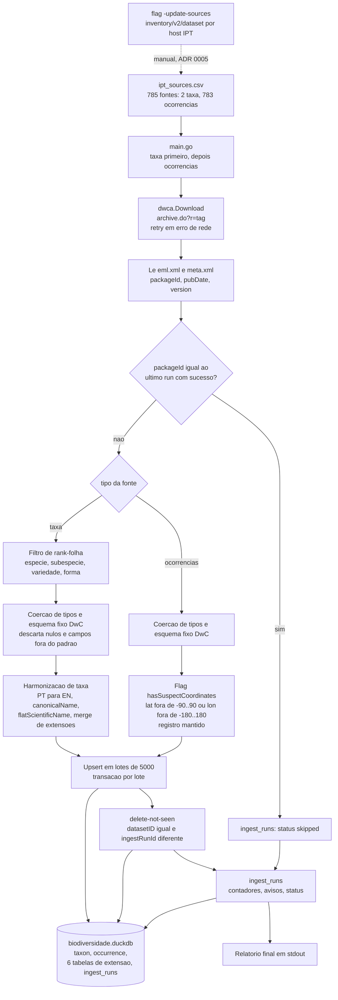
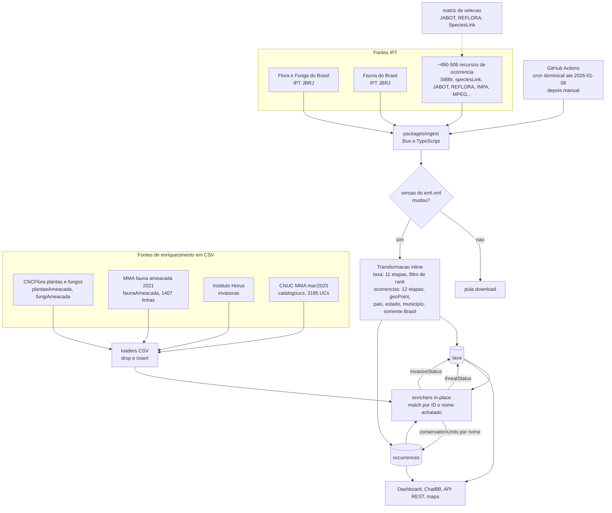

# Ingestão de dados: evolução do pipeline e fontes adicionais

> Convenções: `tag:caminho` = arquivo lido com `git show <tag>:<caminho>`; `hash` = commit; `[INFERÊNCIA]` = não verificado diretamente.
> Termos de `CONTEXT.md` (HEAD): **Fonte IPT**, **Harmonização**, **Execução (Ingest Run)**, **Tabela de extensão**.
> Repositório: `edalcin/BiodiversidadeDB` (nomes históricos: `edalcin/DarwinCoreJSON`, depois `biopinda/Biodiversidade-Online`).

## 0. Resumo executivo

- A ingestão sempre teve o mesmo esqueleto: **IPT → baixar DwC-A → ler `meta.xml`/`eml.xml` → pular se a versão não mudou → converter → gravar**. O que mudou foi o motor (Deno/TS + MongoDB → Bun/TS + MongoDB → Go + MongoDB → Go + DuckDB), o grau de Harmonização e o agendamento.
- **Taxa e ocorrências são as únicas fontes ingeridas no HEAD.** Espécies ameaçadas (flora, fungos, fauna), espécies invasoras e Unidades de Conservação (UCs) existiram como coleções de apoio no MongoDB (a partir de jan/2024 e, de forma consolidada, mai/2025 a fev/2026) mas **não foram portadas** para a versão V7 (Go) nem para a versão DuckDB (HEAD). Ver §3.
- Só o recurso do JBRJ (Flora e Funga do Brasil e Fauna do Brasil) e as coleções de ocorrência vêm de **Fontes IPT**. As fontes adicionais vinham de **arquivos CSV** de órgãos federais (MMA/ICMBio/CNCFlora) e do Instituto Hórus, carregados manualmente.

---

## 1. Ingestão por era

### 1.1 Era DWC2JSON: `v0.1-alpha` (tag 2023-12-23; release 2024-01-04) e `v0.2-alpha` (tag 2024-03-05)

**Origem do projeto.** `v0.1-alpha:README.md`: "# ___Darwin Core Archive to JSON___ - Flora e Funga do Brasil". Objetivo declarado: "Criar uma ferramenta livre, gratuita e de código que ofereça os dados publicados pela Flora e Funga do Brasil em formato Darwin Core Archive no IPT, em formato JSON". Justificativa: a estrutura relacional do DwC-A exige "um esforço adicional para relacionar e integrar as diferentes tabelas", e a base da Flora tinha "mais de 135.000 nomes científicos". O README de `v4.0` diz que o projeto "iniciou em novembro de 2023".

**Fontes (v0.1-alpha).**

| Fonte | Origem | Formato | Evidência |
|---|---|---|---|
| Flora e Funga do Brasil | IPT do JBRJ, recurso `lista_especies_flora_brasil` | DwC-A (core Taxon + extensões) | `v0.1-alpha:README.md`; `v0.1-alpha:.github/workflows/update-mongodb-flora.yml` |
| Catálogo Taxonômico da Fauna do Brasil | IPT do JBRJ, recurso `catalogo_taxonomico_da_fauna_do_brasil` | DwC-A | `v0.1-alpha:.github/workflows/update-mongodb-fauna.yml` (`DWCA_URL: https://ipt.jbrj.gov.br/jbrj/archive.do?r=catalogo_taxonomico_da_fauna_do_brasil`) |
| Ocorrências | `referencias/sources.json`: 9 IPTs com 417 datasets (contagem feita por mim sobre o JSON) | DwC-A (core Occurrence) | `v0.1-alpha:referencias/sources.json`; `v0.1-alpha:src/ocorrencia.ts` |

**Ordem em que as fontes entraram (relato do próprio projeto).** `v0.2-alpha:README.md`: primeiro só a Flora; "Com a publicação dos dados do Catálogo Taxonômico da Fauna do Brasil [...] surgiu a ideia de também incorporar os dados da fauna"; depois, "uma vez que o código implementado era genérico o suficiente para reconhecer e automatizar a conversão de diferentes 'cores', como o de 'ocorrências'", criou-se uma coleção de ocorrências.

**Scripts (Deno + TypeScript).** `src/flora.ts`, `src/fauna.ts`, `src/ocorrencia.ts`, `src/lib/dwca.ts` (`v0.1-alpha`). Cada um vira um workflow do GitHub Actions (`update-mongodb-*.yml`, `runs-on: [self-hosted]`, `deno run -A src/…`).

**Passos de limpeza, seleção e Harmonização (v0.1-alpha).**

| Passo | Onde | Detalhe |
|---|---|---|
| Filtro de rank folha | `src/fauna.ts`, `src/flora.ts` | mantém só `['ESPECIE','VARIEDADE','FORMA','SUB_ESPECIE']`; gêneros, famílias etc. são descartados |
| Sinônimos | `src/fauna.ts` | `resourcerelationship` vira `othernames: [{taxonID, scientificName, taxonomicStatus}]` |
| Classificação superior | `src/fauna.ts`, `src/flora.ts` | `higherClassification` reduzida ao 2º componente de `split(';')` (issue citada no código: `edalcin/DarwinCoreJSON#13`) |
| Reino fixo | `src/fauna.ts` | `taxon.kingdom = 'Animalia'` |
| Nome canônico | `src/fauna.ts`, `src/ocorrencia.ts` | `canonicalName` = gênero + epíteto específico + epíteto infra-específico |
| Pular se versão igual | `src/ocorrencia.ts` | lê `eml.do?r=<tag>`, compara `ipt.version` com a versão guardada na coleção `ipts`; "already on version …" e `continue` |
| Substituir dados da fonte | `src/ocorrencia.ts` | `deleteMany({iptId})` e `insertMany` em lotes de 5000 (`safeInsertMany` reduz o lote à metade se passar do limite de 16 MB do BSON) |
| Substituir taxa por reino | `src/flora.ts` | `deleteMany({$or:[{kingdom:'Plantae'},{kingdom:'Fungi'}]})` antes de inserir |
| Índices | os três scripts | `scientificName`, `canonicalName`, `iptId`, `ipt`, `kingdom`, `taxonID+kingdom` |

**Armazenamento.** Banco MongoDB `dwc2json`; coleções `taxa` (fauna + flora, com extensões **aninhadas** no documento), `ocorrencias` e `ipts` (controle de versão por recurso). Evidência: `v0.1-alpha:src/ocorrencia.ts` (`client.db('dwc2json').collection('ocorrencias')`, `'ipts'`).

**Agendamento.** Em `v0.1-alpha` os workflows disparavam por `push` em `main` (filtro por `paths`) ou `workflow_dispatch`. O `cron` foi adicionado em 2024-03-27 (`b1e595b` "Adiciona CRON para importações"), logo depois de `v0.2-alpha`.

**O que `v0.2-alpha` acrescenta à ingestão** (`git diff --stat v0.1-alpha v0.2-alpha`):

- `referencias/sources.json` substituído por `referencias/occurrences.csv` (459 linhas, 458 recursos; tag/repositório/kingdom/url por linha).
- `src/ocorrencia.ts` passa a gerar `geoPoint` GeoJSON `{type:'Point', coordinates:[longitude, latitude]}` **somente se** `decimalLatitude`/`decimalLongitude` são numéricas e dentro de −90..90 e −180..180; `canonicalName` agora usa `genus`, `genericName`, `subgenus`, `infragenericEpithet`, `specificEpithet`, `infraspecificEpithet`, `cultivarEpiteth`.
- **Curadoria de duplicatas entre repositórios:** `referencias/matrizSelecaoFontes.md` (`v0.2-alpha`): "Alguns recursos, especialmente herbários, estão publicados em diferentes repositórios (IPTs). Para evitar duplicação de registros de ocorrência na base, [...] foi usada a matriz abaixo". Regra: JABOT > REFLORA > SpeciesLink quando o mesmo recurso está em mais de um. Há também `referencias/dataHandling/herbariosDuplicadosRefloraJabot.csv` (124 siglas de herbário com colunas `sigla,reflora,jabot`).
- Primeira fonte adicional: `referencias/threatStatus.csv` (ver §2.1).

**Números citados no README de `v0.2-alpha`:** "cerca de 278 mil nomes de espécie e cerca de 12 milhões de fichas de ocorrências, provenientes de [458] recursos publicados em 10 diferentes IPTs". Também: "todo o banco de dados é atualizado em poucos minutos, apenas clicando nas 'actions'". Pelo `git ls-tree`, o `occurrences.csv` de `v0.2-alpha` tem 458 linhas de dados e 10 valores distintos de repositório (conferido por mim).

### 1.2 Era MongoDB + workflows agendados: `v4.0` a `v6.1` (2025-04-21 a 2026-02-17)

**Tags e datas** (`git tag -l --format='%(refname:short) %(creatordate:short)'`): v4.0/v4.0.0/v4.0.1 2025-04-21; v5.0 2025-05-25; v5.1 e v5.2 2025-07-12; v6.0 2025-09-22; v6.1 2026-02-17. Notas de release: `gh release view <tag>`.

**Fontes.** Mesmas duas fontes taxonômicas (JBRJ) + ocorrências. Números nos READMEs:

| Tag | Citação (README) | Fonte |
|---|---|---|
| v4.0 | "mais de 290 mil nomes"; "15 diferentes IPTs, disponibilizando 493 conjuntos de dados de ocorrências" | `v4.0:README.md` |
| v5.0 | "Cerca de 12 milhões de registros de ocorrência da fauna e flora, provenientes de cerca de 490 repositórios (IPTs)" | `v5.0:README.md` |
| v6.0 | "mais de 290 mil nomes científicos"; "~12 milhões de registros de ocorrência de ~490 repositórios IPT" | `v6.0:README.md` |
| v6.1 | "~490 repositórios IPT"; `funcionamento.md`: "~505 colecoes" | `v6.1:README.md`; `v6.1:docs/funcionamento.md` |

Contagem de linhas de `occurrences.csv` (por mim, via `git show`): v4.0 = 493 linhas (12 repositórios distintos), v5.0 = 494 (11), v6.0 e v6.1 = 506 (11). Há uma diferença entre "15 IPTs" (README) e os 11–12 valores de `repositorio` no CSV; a contagem de IPTs não é a mesma coisa que a de valores de `repositorio` `[INFERÊNCIA]`.

**Agendamento (workflows do GitHub Actions, `runs-on: [self-hosted]`).**

- `v4.0`, `v5.0`, `v6.0`: `schedule` semanal, **domingo**: fauna `30 2 * * 0`, flora `0 2 * * 0`, ocorrências `0 3 * * 0` (UTC) + `workflow_dispatch` (`v4.0:.github/workflows/update-mongodb-*.yml`). README v4.0: "todo o domingo 3 'actions' de atualização da base de dados no MongoDB são acionadas".
- Cron introduzido em `b1e595b` (2024-03-27); removido em `6173728` (2026-01-08, "Simplificar configuração e tornar workflows manuais"). Em `v6.1` todos são `workflow_dispatch` apenas (`v6.1:docs/workflows.md`: "Manual apenas"; README: "Todos os workflows são **manuais**").
- Diagrama do fluxo de atualização: `v4.0:atualizacao.md` (stateDiagram: acessaIPT → download → monta relação → converte JSON → carga MongoDB).

**Armazenamento em cada marco.**

- v4.0 a v5.x: coleções `taxa`, `ocorrencias`, `ipts` (+ coleções de apoio de §2 e a view `calFeno`). Docs: `v4.0:esquema.md`, `v5.0:chatbb.md`.
- v6.0/v6.1 (monorepo `packages/ingest`, `packages/transform`, `packages/web`, commit `a5ea5fd` 2025-09-17): `taxa_ipt`/`occurrences_ipt` (dados brutos), `taxa`/`occurrences` (curados), `ipts`, `processingLocks`, `transform_status`, `process_metrics` (`v6.1:packages/ingest/src/config/collections.ts`; `v6.1:docs/funcionamento.md` §6). Bun/Node.js, TypeScript. Refactors de abril-novembro: `8e750d0` (2025-10-30, separa ingest e transform) e `12b7c47` (2025-11-03, "Transforma ao ingerir"). A pasta de dados brutos desaparece depois: `7a4c3e7` (2026-02-18) "Abandona o pipeline de 2 estágios (taxa_ipt → taxa)".

**Passos de limpeza/seleção/Harmonização no V6.x** (`v6.1:docs/funcionamento.md` §4–5; código em `v6.1:packages/transform/src/…`):

*Verificação de versão e download.* `VerificadorVersao` lê `eml.xml`, extrai a versão do `@packageId`, compara com a coleção `ipts`, "Se a versão é idêntica, pula o download"; verificação em paralelo de todos os IPTs (10 concorrentes). IDs determinísticos: taxa `P`+taxonID (flora) ou `A`+taxonID (fauna); ocorrência `{occurrenceID}::{iptId}`, com fallback `SHA1(iptId|catalogNumber|recordNumber|eventDate|locality|recordedBy)`.

*Pipeline de taxa (11 etapas).* `validate-and-clone`, `filter-by-taxon-rank` (ESPECIE, VARIEDADE, FORMA, SUB_ESPECIE), `build-canonical-name`, `build-flat-scientific-name`, `normalize-higher-classification`, `normalize-kingdom`, `normalize-vernacular-names` (minúsculas, hífen, idioma default "Portugues"), `extract-distribution`, `normalize-species-profile`, `convert-resource-relationship`, `force-animalia-kingdom`.

*Pipeline de ocorrências (12 etapas).* Inclui `build-geo-point` (lat −90..90, lon −180..180), conversão de `year/month/day` para número, parse de `eventDate`, `normalize-country`, `normalize-state`, `normalize-county`, e `check-brazilian-and-set-reproductive`, que **filtra registros não-brasileiros** e detecta "flor" em `remarks` (insumo do calendário fenológico).

*Exemplos antes/depois do V6.x* (de `funcionamento.md`):

| Campo | Antes | Depois |
|---|---|---|
| país | `"brazil"`, `"BRASIL"` | `"Brasil"` |
| estado | `"rj"` / `"RJ"` / `"rio de janeiro"` | `"Rio de Janeiro"` |
| estado | `"sp"` / `"São Paulo"` | `"Sao Paulo"` (mapa com "78+ variações" para 27 estados) |
| distribuição (flora) | array de linhas `{locationID:"AC", establishmentMeans:"Native", …}`, `{locationID:"AM", …}` | objeto `{origin:"Native", Endemism:"Endemic", occurrence:["AC","AM"], …}` |
| coletores | `recordedBy` string | array, separado por `;` ou `,` (`defaultCollectorParser` em `v6.1:packages/transform/src/occurrences/enrichOccurrence.ts`) |
| vínculo ocorrência→táxon | `taxonID` / nome achatado | `taxonID`, `scientificName`, `canonicalName`, `kingdom` do `taxa` (4 mapas em memória) |

Índices: "45+ índices", incluindo `geoPoint_2dsphere` (`funcionamento.md` §4.8, §6.2). Tratamento de erros: `safeInsertMany` para o limite de 16 MB; locks em `processingLocks`/`transform_status` (padrão 2 h).

**Números dos docs do V6.** Pré-V7: taxa "~100K-300K registros" em memória (`funcionamento.md` §4.3); ocorrências "~505 coleções". Modo de leitura: taxa em JSON em memória, ocorrências em SQLite em memória com lotes de 5000.

### 1.3 Era V7 (Go + MongoDB): commits `63666df..` (2026-05-07 a 2026-09-13)

**Contexto da decisão.** `specs/001-refactor-acquisition/spec.md` (criada 2026-05-05, lido em `dd14da5^`): "Refatorar todo o projeto, focando no contexto de aquisição e eliminando os contextos de Enriquecimento e Apresentação. [...] Sem Docker, sem GitHub Actions, sem interface. Três scripts para Windows 11 [...] Go". Alvos de desempenho: fauna ≤ 2 min, flora ≤ 2 min, ocorrências ≤ 30 min para 5M registros.

**Marcos de commit (`git log --reverse 63666df^..HEAD`).**

| Commit | Data | O que |
|---|---|---|
| `63666df` | 2026-05-07 | "implementar contexto de aquisição Go (V7) — Phases 1-5" |
| `47a13b7` | 2026-05-07 | múltiplas fontes IPT para ocorrências via CSV |
| `20e32a3` | 2026-05-07 | remove contextos V6 (Astro/Bun/TS/workflows) |
| `64bace0` | 2026-05-07 | coleção `taxa` com extensões DwC-A e filtro de rank |
| `3cda789` | 2026-05-10 | reorganiza em `contextos/aquisicao/` e `contextos/comum/` |
| `06fccd6` | 2026-05-11 | "harmonize PT->EN DwC values on taxa ingestion" |
| `4a0e930` | 2026-05-11 | pula ingestão com `packageId` idêntico + relatório final |
| `8f6e42c` | 2026-05-14 | trata `BSONObjectTooLarge` |
| `fcaa31e` | 2026-05-14 | salva relatório final `.md` em `reports/` a cada execução |
| `b782b55` | 2026-05-20 | remove o código V6.1 (Astro/Node.js) arquivado |

**Fontes e binários.** `README.md` em `dd14da5^`: três binários Go (`update-fauna`, `update-flora`, `update-occurrences`); fontes: IPT Flora do Brasil, IPT Fauna do Brasil e "505+ IPTs" listados em `contextos/aquisicao/data/occurrences.csv`. O mesmo README marca Curadoria, Enriquecimento (ameaças, invasoras, UCs) e Apresentação (Dashboard, ChatBB, API REST) como "🔜 Planejado" `[a tabela de status está no README em dd14da5^]`.

**Passos.** `funcionamento.md` V7 (`dd14da5^:contextos/aquisicao/docs/funcionamento.md`): download → abrir arquivo → `meta.xml`/`eml.xml` → ler core → filtro de rank → coerção → upsert em lote → delete-not-seen → auditoria. Escolha explícita na especificação: **passthrough completo** ("o documento MongoDB espelha todos os campos do DwC-A original, com normalização mínima de tipos") e, **originalmente**, "Sempre baixa e processa" (depois alterado por `4a0e930` para pular quando o `packageId` é igual). `docs/atualizacao.md` V7: "V7 = pipeline integrado em um único processo Go por fonte. Não há etapa separada de 'transform'".

**Armazenamento (V7).** MongoDB `dwc2json`: coleções `taxa` (com `source:"fauna"` ou `"flora"`), `occurrences` (`source:<tag>`), `ingest_runs`. Docs falam em "~50K taxa" para a flora e "~120K taxa" para a fauna após o filtro de rank (`dd14da5^:contextos/aquisicao/docs/atualizacao.md`, afirmação do doc, não medida por mim).

**Agendamento.** Nenhum; execução manual dos binários no Windows 11.

### 1.4 Era DuckDB, script único: `dd14da5` (2026-09-14) até HEAD (`c0f6a41`, 2026-10-28)

**O que mudou em `dd14da5`** ("substituir MongoDB por DuckDB, colapsar suite em script único"): ADRs 0001–0004, `main.go` na raiz, `ipt_sources.csv` único, esquema fixo Darwin Core, tabelas de extensão. Commits seguintes: `5beac94` (2026-09-14, remove scaffolding speckit/openwiki, adiciona AGENTS.md/husky), `7290bc9` (2026-09-17, retry em falhas de DNS no download), `ac51446` (2026-09-17, `reports/occurrence_unique_values.md`), `a708577` (2026-09-17, atualização manual de `ipt_sources.csv`, ADR 0005), `c0f6a41` (2026-10-28, dependabot #65).

**Fontes (HEAD).** `ipt_sources.csv`, colunas `tipo,nome,repositorio,kingdom,tag,url`. Ver contagens em §4.

**Pipeline, passo a passo (código em `internal/ingest/pipeline.go`, `transform.go`, `taxa_transform.go`, `extensions.go`; `internal/dwca/`; `internal/duckstore/`).**

1. **Ordem.** `orderSources` coloca todas as fontes `taxa` antes das `ocorrencias` (`main.go`); uma conexão de escrita (ADR 0002).
2. **Download e cache.** `dwca.Download` com retry (`isRetryable`: server error, timeout, connection refused, i/o timeout, no such host); o ZIP é apagado ao final (`ea5bb17`, `pipeline.go`).
3. **Leitura de metadados.** `eml.xml` → `packageId`, `pubDate`, `version`, `title`; `meta.xml` → core e extensões.
4. **Pular se igual.** `Store.LastSuccessfulRun(source)`; se `packageId` atual == `packageId` da última execução com `status='success'`, a Execução é gravada como `skipped` (`pipeline.go`).
5. **Seleção (filtro de rank-folha).** Só táxons com `taxonRank` em `ESPECIE`, `SUB_ESPECIE`, `SUBESPECIE`, `VARIEDADE`, `FORMA`, `SPECIES`, `SUBSPECIES`, `VARIETY`, `FORM` (maiúsculas/minúsculas e `-` tratados). Descarta GENERO, FAMILIA, ORDER, CLASS, PHYLUM, KINGDOM, DIVISION, vazio, "unranked" (`TestShouldKeepTaxon`). Cada descarte incrementa `recordsRejected`.
6. **Coerção de tipos e esquema fixo.** `coerceRecord`: valores `""`, `\N`, `null`, `NULL`, `NA` são omitidos; datas (`2026-04-30`, `2026-04`, `2026`, intervalo `2026-01-01/2026-12-31` → usa o início), `float` (`decimalLatitude`), `int` (`year`); campos fora do esquema são descartados e contados em `recordsWithUnknownFields`; strings acima de 32 KB são truncadas.
7. **ID.** Chave `taxonID` / `occurrenceID`; se faltar em taxa, fallback `<source>:<scientificNameID>` ou `<source>:<scientificName>:<authorship>`; sem ID, o registro é rejeitado. `datasetID` = `tag` da fonte; `datasetName` = coluna `nome`.
8. **Harmonização de taxa (apenas taxa).** `enrichTaxonDoc`: PT→EN em `taxonomicStatus` e `taxonRank`; `canonicalName`; `flatScientificName`; normalização das extensões (abaixo).
9. **Sinalização de coordenadas suspeitas (apenas ocorrências).** `checkCoordinates`: `hasSuspectCoordinates = true` se `decimalLatitude` fora de −90..90 ou `decimalLongitude` fora de −180..180; **o registro não é descartado**; até 100 avisos por execução vão para `ingest_runs.warnings`.
10. **Upsert.** Lotes de `BULK_BATCH_SIZE` (padrão 5000); `UpsertTaxa` e `UpsertOccurrences`; em taxa as linhas de extensão são apagadas e reinseridas na mesma transação; contadores `inserted`/`updated`.
11. **Delete-not-seen.** `DELETE … WHERE datasetID = ? AND ingestRunId <> ?`, por fonte; em taxa apaga primeiro as linhas de extensão.
12. **Auditoria.** `ingest_runs` (27 colunas: contadores, status, `dwcaPackageId`, `dwcaPubDate`, `dwcaVersion`, `warnings`…).

**Exemplos concretos de antes → depois (todos de testes em `internal/ingest/*_test.go`):**

| Etapa | Antes (bruto) | Depois (DuckDB) | Teste |
|---|---|---|---|
| status | `NOME_ACEITO`, `nome_aceito` | `accepted` | `TestNormalizeTaxonomicStatus` |
| status | `SINONIMO` | `synonym` | idem |
| status | `DOUBTFUL`, `accepted` | inalterados (passthrough) | idem |
| rank | `ESPECIE`, `SUB_ESPECIE`/`sub-especie`, `VARIEDADE`, `FORMA` | `species`, `subspecies`, `variety`, `form` | `TestNormalizeTaxonRank` |
| rank | `GENUS` | `GENUS` (passthrough; mas o filtro rejeita antes) | idem |
| `canonicalName` | `genus="Paubrasilia"`, `specificEpithet="echinata"` | `Paubrasilia echinata` | `TestBuildCanonicalName` |
| `canonicalName` | `Hibiscus` + `rosa-sinensis` + `alba` | `Hibiscus rosa-sinensis alba` | idem |
| `flatScientificName` | `Paubrasilia echinata (Lam.) Gagnon, H.C.Lima & G.P.Lewis` | `paubrasiliaechinatalamgagnonhclimagplewis` | `TestBuildFlatScientificName` |
| distribuição | 3 linhas: `BR-AL`, `BR-BA`, `BR-AL` (repetida), `establishmentMeans=NATIVA`, `occurrenceRemarks="endemism:Endemica;phytogeographicDomain:[Mata Atlântica];vegetationType:[…]"` | uma linha: `occurrence=[BR-AL, BR-BA]`, `origin=NATIVA`, `Endemism=Endemica`, `phytogeographicDomains=[Mata Atlântica]`, `vegetationType` com 2+ valores | `TestNormalizeDistribution` |
| `countryCode` | lista multivalorada | `[AG, AI, AR, …, BR]` deduplicada | `TestNormalizeDistribution_CountryCodeMultiValue` |
| nome vernáculo | sem `language` | `language = "Portugues"` | `normalizeVernacular` |
| perfil | `lifeForm`/`habitat` com `;` ou `,` | listas (`[Árvore, Arbusto]`, `[Terrícola]`) | `TestNormalizeSpeciesProfile` |
| tipos | `"2026-04-30"` | `time.Time`; `"-23.5"` → `float64`; `"2026"` → `int64` | `TestCoerceRecord_TypeCoercions` |
| nulos | `""`, `\N`, `NULL` | omitidos | `TestCoerceRecord_OmitsNullValues` |
| campo fora do esquema | `someRandomCol` | descartado, `dropped = 1` | `TestCoerceRecord_DropsUnknownFields` |

**Dedupe/merge de extensões.** `normalizeDistribution` deduplica `locationID` e `countryCode`, pega o primeiro `establishmentMeans`/`endemism` não vazio; `normalizeSpeciesProfile` separa por `;`/`,` e deduplica; extensões em RAM por `taxonID` (`loadTaxonExtensions`). Cada extensão acaba em tabela própria (ADR 0004).

**Armazenamento (HEAD).** DuckDB único: `taxon`, `occurrence`, 6 Tabelas de extensão (`taxon_vernacular_name`, `taxon_distribution`, `taxon_species_profile`, `taxon_reference`, `taxon_types_and_specimen`, `taxon_resource_relationship`, FK `taxonID`) e `ingest_runs` (`internal/duckstore/schema.go`: 9 tabelas). `occurrence` tem colunas DwC fixas mais `hasSuspectCoordinates`, `ingestRunId` e `ingestedAt` (número exato de colunas não contado).

**Agendamento.** Nenhum: README, "executa manualmente (ou agenda como preferir)"; sem Docker nem CI (`dd14da5`).

**Atualização do inventário.** ADR 0005 / `sourcesync.go`: a flag `-update-sources` consulta `inventory/v2/dataset?type=dwca` de cada host IPT (timeout de 15 s, sem retry) e só mexe nas linhas dos hosts que responderam; `kingdom` e `repositorio` seguem curados à mão (`CONTEXT.md`, "Inventário do IPT").

### 1.5 Comparação lado a lado

| Aspecto | v0.1/v0.2 (2023-24) | v4–v5 (2025) | v6.x (2025-26) | V7 (mai–set 2026) | HEAD (set–out 2026) |
|---|---|---|---|---|---|
| Linguagem | Deno + TS | Deno 2 + TS | Bun/Node + TS | Go | Go |
| Banco | MongoDB | MongoDB | MongoDB | MongoDB | DuckDB (1 arquivo) |
| Execução | 3 scripts/workflows | 3 workflows | 3 ingestões + transform/enrich | 3 binários | 1 binário |
| Agenda | push + (a partir de 2024-03-27) cron dom. | cron dom. | cron até 2026-01-08; depois manual | manual | manual |
| Fonte de ocorrência | `sources.json` → `occurrences.csv` (458) | `occurrences.csv` (493–494) | `occurrences.csv` (506) | `data/occurrences.csv` (505+) | `ipt_sources.csv` (785 linhas) |
| Harmonização | filtro de rank, `canonicalName`, `geoPoint` | idem | 11 etapas taxa, 12 ocorrências, enriquecimento | passthrough + coerção | esquema fixo, PT→EN (taxa), flag de coordenada |
| Extensões de táxon | aninhadas no JSON | aninhadas | aninhadas | aninhadas | tabelas normalizadas |
| Fontes adicionais | `threatStatus.csv` | + invasoras, UCs, fauna ameaçada | + CNCFlora Plantae/Fungi, enriquecimento in-place | **nenhuma** | **nenhuma** |

---

## 2. Fontes adicionais (além de taxa e ocorrências)

> Linha do tempo resumida: 2024-01-13 (lista de ameaçadas, Portaria MMA 148/2022) → 2024-03-28 (consulta de invasoras em Parques Nacionais) → 2025-05-17..25 (ChatBB: CNCFlora, invasoras, UCs e fauna ameaçada formalizadas) → 2025-08-19 (CNCFlora separa Plantae e Fungi) → 2026-02-18 (loaders CSV reais + enriquecedores in-place) → 2026-05-07 (V7 remove tudo).

### 2.1 Espécies ameaçadas, lista da Portaria MMA nº 148/2022 (`threatStatus`) — **flora e fauna**

- **Chegada.** `4bb3493` (2024-01-13): "Lista de espécies ameaçadas da Portaria MMA Nº 148, de 7 de junho de 2022", `referencias/threatStatus.csv`. Presente em `v0.2-alpha`, `v4.0`; **não aparece mais em `v5.0`** (substituída pelas fontes do ChatBB abaixo).
- **Origem e formato.** CSV `kingdom,order,family,canonicalName,threatStatus,source`; a coluna `source` vale "Portaria MMA Nº 148, de 7 de junho de 2022" nas 4467 linhas. Órgão: Ministério do Meio Ambiente (MMA).
- **Números (por mim, a partir de `v0.2-alpha:referencias/threatStatus.csv`).** 4467 espécies: 3209 Plantae e 1258 Animalia; categorias EN 2268, VU 1146, CR 1004, CR (PEX) 39, EX 6, RE 3, EW 1.
- **Como foi ingerida.** Não há script de carga no repositório `[INFERÊNCIA]`: o CSV é usado em agregações MongoDB que assumem uma coleção `threatStatus` já existente (importada manualmente, p.ex. `mongoimport`). Evidência: `v0.2-alpha:referencias/agregacoes/taxa/taxaThreatStatus.js` (`$lookup from:"threatStatus", localField:"canonicalName", foreignField:"canonicalName"`).
- **Ligação.** Por nome: `taxa.canonicalName` = `threatStatus.canonicalName`. Também `agregacoes/emViews/taxaThreatStatus/` (`filtroGenericoAmeacadas.js`, `listaSinonimosAmeacados.js`; este último de `55380c6`, 2024-01-18) e `animaliaAmeacados202402.js` (`7f62e30`, 2024-02-14).
- **Coleção.** `threatStatus` (MongoDB `dwc2json`).

### 2.2 Espécies invasoras — Instituto Hórus (`invasoras`)

- **Chegada.** Consulta de agregação `referencias/agregacoes/occurence/invasorasEmParquesNacionais.js` em `4db83ed` (2024-03-28); presente em `v4.0` em diante. O ChatBB documenta a coleção em `271774c` (2025-05-18, "melhorias no prompt agregando a coleção de invasoras").
- **Origem e formato.** `v6.1:docs/chatbb.md`: "Banco de dados de espécies invasoras do [Instituto Hórus](https://institutohorus.org.br/)". O arquivo de dados **não está no repositório** (nem em nenhuma tag; `git log --all --name-only` não lista CSV de invasoras). O esquema aparece no prompt (`v6.1:packages/ingest/chatbb/fontes/promptV1.txt`): `scientific_name`, `kingdom`, `family`, `genus`, `origin`, `native_distribution_area`, `invasion_preferential_environments`, `biodiversity_impact`, `economic_impact`, `common_name`, `prevention`, `physical_control`, `chemical_control`, `voc_dispersal_routes`, `voc_dispersion_vectors`, entre outros (aprox. 30 campos).
- **Ingestão.** (a) 2024-25: coleção `invasoras` carregada manualmente `[INFERÊNCIA]`; (b) `7a4c3e7` (2026-02-18): `loadInvasoras.ts` (`bun run load:invasoras -- <csv>`): detecta delimitador, **drop + insert** da coleção, índice em `scientific_name`; `enrichInvasoras.ts` itera `taxa` e grava `invasiveStatus: {source:"invasoras", isInvasive:true, notes?}` por `$set` (ou `$unset` se não casar).
- **Ligação.** `invasoras.scientific_name` ↔ `taxa.canonicalName` ↔ `ocorrencias.canonicalName` (prompt: item 7/13). Match duplo (ID e nome achatado) em `packages/transform/src/utils/lookup.ts`.
- **Consulta emblemática.** "invasoras em Parques Nacionais": ocorrências com `locality` casando `/parque nacional/i` + `$lookup` em `invasoras` (`invasorasEmParquesNacionais.js`). Exemplos de perguntas do ChatBB: "Quais as espécies invasoras de árvores ocorrem nos parques nacionais?" (`v6.1:docs/chatbb.md`).
- **Coleção.** `invasoras`; campo derivado `taxa.invasiveStatus`.
- **Números.** Não verificáveis no repositório (sem arquivo) `[lacuna]`.

### 2.3 Fauna ameaçada — MMA, "Lista de Espécies Ameaçadas 2021" (`faunaAmeacada`)

- **Chegada.** `7f62e30` (2024-02-14) já tem uma agregação `animaliaAmeacados202402.js`; o CSV específico `chatbb/fontes/fauna-ameacada-2021.csv` foi enviado em `e348e3a` (2025-05-20) e a coleção entra no prompt em `06f786d` (2025-05-20, "inclui ameaçadas da fauna"). Em `v5.0` o arquivo existe.
- **Origem e formato.** `v6.1:docs/chatbb.md`: "[FAUNA - Lista de Espécies Ameaçadas - 2021](https://dados.mma.gov.br/dataset/especies-ameacadas/resource/544f9312-d4c6-4d12-b6ac-51bf3039bbb7)". CSV com `;`, colunas `higherClassification;order;family;canonicalName;threatStatus` (rótulos como "Vulnerável (VU)").
- **Números (por mim, `v6.1:packages/ingest/chatbb/fontes/fauna-ameacada-2021.csv`).** 1407 linhas de dados: VU 472, EN 425, CR 325, LC 64, CR (PEX) 36, DD 35, NT 35, EX 6, RE 3, EW 1, CR escrito de outra forma 1, e 4 linhas de nota ("[Sinonímia M. hypostoma]", "[Não é espécie brasileira]", "[Não é mais táxon válido]", "Subespécie que sai da Lista"). Ou seja, ~1403 são espécies/avaliações e o arquivo traz ruído editorial.
- **Ingestão.** Antes: carga manual `[INFERÊNCIA]`; depois: `loadFaunaAmeacada.ts` (CSV → drop + insert) e `enrichAmeacadas.ts` (`taxa.threatStatus = [{source:"faunaAmeacada", category:"Em Perigo (EN)"}]`) em `7a4c3e7`.
- **Ligação.** `faunaAmeacada.canonicalName` ↔ `taxa.canonicalName`.
- **Coleção.** `faunaAmeacada`.

### 2.4 Flora e fungos ameaçados — CNCFlora (`cncflora2022` → `cncfloraPlantae`/`cncfloraFungi` → `plantaeAmeacada`/`fungiAmeacada`)

- **Chegada.** `1f8937b` (2025-05-17): "prompt incluindo a coleção cncflora2022 com dados de espécies ameaçadas". `603d434` (2025-08-19): "Plantae: alterado de cncflora2022 para cncfloraPlantae; Fungi: [...] cncfloraFungi" (Fungi passa a ter coleção própria). `455af6d` (2025-09-30): prompt atualizado; as coleções se ligam a `taxa` por "Flora e Funga do Brasil ID" ↔ `taxonID`. `7a4c3e7` (2026-02-18): renomeadas para `plantaeAmeacada`/`fungiAmeacada`.
- **Origem.** `v6.1:docs/chatbb.md`: "Espécies da flora avaliadas quanto ao risco de extinção pelo [CNCFlora](https://cncflora.jbrj.gov.br/), até 2022"; `v6.1:docs/dashReadme.md`: "Dados do 'Painel de Dados do Centro Nacional de Conservação da Flora'". Instituição: CNCFlora/JBRJ. Formato: CSV (loaders). O CSV **não está no repositório** `[lacuna]`.
- **Categorias.** `EN | VU | NT | CR | LC | DD` (`promptV1.txt`).
- **Ingestão e ligação.** `loadPlantaeAmeacada.ts`/`loadFungiAmeacada.ts`; ligação por `taxonID` (preferencial) ou nome achatado.
- **Números.** Não verificáveis (sem arquivo) `[lacuna]`.

### 2.5 Unidades de Conservação — CNUC/MMA (`ucs` → `catalogoucs`)

- **Chegada.** `e7dc29e` (2025-05-20): "Ajuste do prompt com inclusão da coleção de UCs"; CSV enviado em `e348e3a` (2025-05-20). Ajustes: `33278f5`, `e41a794` (2025-05-21, "relação de UCs com suas ocorrências"), `5eae779` (2025-05-26).
- **Origem e formato.** `v6.1:docs/chatbb.md`: "Lista das UCs ativas no CNUC [...] Dados atualizados até março/2025" (CNUC, Ministério do Meio Ambiente; link `dados.mma.gov.br/dataset/unidadesdeconservacao`). Arquivo `chatbb/fontes/cnuc_2025_03.csv`, separado por `;`, UTF-8 com BOM, 40+ colunas (`ID_UC`, `Código UC`, `Nome da UC`, `Esfera Administrativa`, `Categoria de Manejo`, `Categoria IUCN`, `UF`, `Ano de Criação`, `Ato Legal de Criação`, `Municípios Abrangidos`, `Plano de Manejo`, `Conselho Gestor`, `Órgão Gestor`, áreas por bioma etc.).
- **Números (por mim, parse com `csv`).** 3185 UCs: esfera Estadual 1316, Federal 1091, Municipal 778; grupo Uso Sustentável 2157, Proteção Integral 1028. (`wc -l` dá 3186 linhas por causa do cabeçalho; as células multi-linha não distorceram a contagem do parse.)
- **Ingestão.** Antes: carga manual `[INFERÊNCIA]`; `7a4c3e7`: `loadCatalogoUCs.ts` (CSV → `catalogoucs`) e `enrichUCs.ts`, que grava `occurrences.conservationUnits = [{ucName:"Parque Nacional da Amazônia"}]`. O código tem o comentário "TODO: Implementar matching geoespacial no futuro. Atualmente faz matching por nome/ID." (`enrichUCs.ts`).
- **Ligação.** No ChatBB: `ucs."Nome da UC"` (caixa alta) é buscado como **substring** no campo `locality` de `ocorrencias` (`promptV1.txt`). Ou seja, é um vínculo textual, não espacial. **O V6.1 tinha também um loader "mock"** (`conservation_units.ts` com polígonos 2dsphere, dados fictícios de exemplo) que foi removido em `7a4c3e7`.
- **Coleção.** `ucs` (ChatBB) / `catalogoucs` (loader); campo derivado `occurrences.conservationUnits`.

### 2.6 Outras fontes/derivados mencionados

| Item | O que é | Chegada | Ingerido de fonte externa? |
|---|---|---|---|
| Bibliografia | extensão DwC-A `Reference` dos taxa de fauna/flora | no código desde V6 (`normalizeReference`); HEAD: tabela `taxon_reference` | sim, como extensão do DwC-A de taxa (não é fonte própria) |
| Espécimes-tipo | extensão `TypesAndSpecimen` | idem; HEAD: `taxon_types_and_specimen` | idem |
| Nomes vernaculares | extensão `VernacularName` | desde v0.1 (aninhado); HEAD: `taxon_vernacular_name` | idem |
| Sinônimos | extensão `ResourceRelationship` | `othernames` (v0.1); HEAD: `taxon_resource_relationship` | idem |
| Coletores | `recordedBy` quebrado em array | V6.x (`enrichOccurrence.ts`) | derivado de ocorrências; **não portado** |
| Fenologia | view `calFeno` (calendário de floração) a partir de `occurrences` (flag "flor" em `remarks`) | `b84a2ec`, `f248a5a`, `ce03475` (2025-09-08) | derivado; vivia no app web, removido em V7 |
| Parques | "parque nacional" via `locality` + UCs | consulta de 2024-03-28; ChatBB 2025-05 | sim (CNUC), ver §2.5 |
| Calendário/Dashboard | contagens de ameaçadas, invasoras | `4f6d206`…`2eb1f9c` (2025-08-18/21) | derivado; app web |
| Interações, diversidade química e genética, uso por comunidades tradicionais | só como possibilidades | `v4.0:README.md` | **não ingerido**: "possibilitar a agregação de outros conjuntos de dados relevantes, como dados de espécies invasoras, dados de avaliação de risco de extinção, dados de interação entre animais e plantas, dados de diversidade química e genética, dado de usos por comunidades tradicionais etc." |

### 2.7 Como o enriquecimento funcionava no último desenho MongoDB (`7a4c3e7`, 2026-02-18)

Mensagem do commit: "Abandona o pipeline de 2 estágios (taxa_ipt → taxa) e implementa enriquecimento diretamente nas coleções principais via $set/$unset. Novos loaders CSV (drop+insert): loadFaunaAmeacada, loadPlantaeAmeacada, loadFungiAmeacada, loadInvasoras, loadCatalogoUCs. Novos enrichers in-place: enrichAmeacadas (threatStatus em taxa), enrichInvasoras (invasiveStatus em taxa), enrichUCs (conservationUnits em occurrences)." Três workflows manuais: `enrich-ameacadas.yml`, `enrich-invasoras.yml`, `enrich-ucs.yml`. `v6.1` (um dia antes, tag 2026-02-17) ainda descrevia essas fontes como "em desenvolvimento" e trazia loaders com **dados fictícios** (`threatened.ts`, `invasive.ts`, `conservation_units.ts`: "This is a mock implementation").

---

## 3. Estado no HEAD: o que ficou e o que não foi portado

| Fonte | MongoDB (último estado: `7a4c3e7`) | V7 (Go + MongoDB) | HEAD (DuckDB) |
|---|---|---|---|
| Flora e Funga do Brasil (IPT JBRJ) | sim | sim | **sim** (`ipt_sources.csv`, `tipo=taxa`) |
| Catálogo Taxonômico da Fauna do Brasil (IPT JBRJ) | sim | sim | **sim** |
| Ocorrências (coleções via IPT) | sim | sim | **sim** (783 fontes no CSV) |
| Extensões de táxon (vernáculo, distribuição, perfil, referências, tipos, sinônimos) | aninhadas | aninhadas | **sim**, tabelas próprias |
| Espécies ameaçadas, flora/fungos (CNCFlora) | sim | **não** | **não** |
| Espécies ameaçadas, fauna (MMA 2021) | sim | **não** | **não** |
| Lista MMA Portaria 148/2022 (`threatStatus`) | removida antes (v5.0) | não | **não** |
| Espécies invasoras (Instituto Hórus) | sim | **não** | **não** |
| Unidades de Conservação (CNUC) | sim | **não** | **não** |
| Coletores (array), fenologia (`calFeno`), filtro "só Brasil" | sim | não | **não** |
| Normalização de país/estado/município | sim (V6) | não (passthrough) | **não** no código; só PT→EN de `taxonomicStatus`/`taxonRank` em taxa |
| Matriz de seleção de herbários duplicados (JABOT>REFLORA>SpeciesLink) | sim | não documentado | **não** no código (grep em `internal/` e `main.go` não acha); `ipt_sources.csv` traz as três origens (jabot 119, reflora 33, speciesLink 135) `[INFERÊNCIA: possível duplicação entre repositórios]` |
| Dashboard, ChatBB, API, mapa | sim | **removidos** de propósito | **fora de escopo** |

Evidências: `README.md` de `dd14da5^` (status "🔜 Planejado" para Enriquecimento) e spec `001-refactor-acquisition` ("eliminando os contextos de Enriquecimento e Apresentação"); `git ls-files` do HEAD (sem `packages/`, sem loaders, sem CSVs de ameaçadas/UCs); `README.md` do HEAD ("Não há mais suite multi-contexto, banco compartilhado ou serviço hospedado").
Os CSVs `cnuc_2025_03.csv` e `fauna-ameacada-2021.csv` seguem na **história** do Git (`v5.0` … `v6.1`; e em `contextos/aquisicao/docs/legacy/…` entre 2026-05-10 e 2026-05-20), mas não existem no `main` atual.

**Declaração honesta para a apresentação:** a base DuckDB atual contém taxa (fauna + flora/fungos) e ocorrências harmonizadas em Darwin Core. Os enriquecimentos temáticos (ameaça, invasoras, UCs) foram parte do projeto até fev/2026 e **foram descontinuados na reestruturação V7 e não foram reimplementados** no HEAD.

---

## 4. Números atuais (medidos nesta pesquisa)

### 4.1 `ipt_sources.csv` (HEAD)

Medido com Python (`csv.DictReader`) sobre o arquivo do worktree em 2026-11-14.

- **785 fontes** (786 linhas com cabeçalho). O `README.md` do HEAD ainda diz "514 fontes — 2 do tipo `taxa` [...] e 512 do tipo `ocorrencias`" (verificado em 2026-09-14); a atualização `a708577` (2026-09-17) levou o CSV de 514 para 785 fontes (CSV antes: 515 linhas → 786 linhas, `git show a708577^:ipt_sources.csv | wc -l`). **O README está desatualizado nesse número.**
- Por `tipo`: **ocorrencias 783**, **taxa 2** (Flora e Funga do Brasil `lista_especies_flora_brasil`; Catálogo Taxonômico da Fauna do Brasil `catalogo_taxonomico_da_fauna_do_brasil`, ambos `https://ipt.jbrj.gov.br/jbrj/`).
- Por `repositorio` (11 valores): sibbr 304, speciesLink 135, jabot 119, taxonline 46, mnrj 43, mpeg 36, mzusp 34, reflora 33, inpa 29, jbrj 3 (2 taxa + 1 ocorrência), goeldi 3.
- Por `kingdom` (ocorrências): vazio 296, Animalia 270, Plantae 208, Fungi 8, "Plantae, Fungi" 1. Taxa: "Plantae;Fungi" e "Animalia".
- Hosts (URL base distinta): `ipt.sibbr.gov.br/sibbr` 304; `ipt1.cria.org.br/ipt` 135; `ipt.jbrj.gov.br/jabot` 119; `ipt.sibbr.gov.br/taxonline` 46; `…/mnrj` 43; `…/goeldi` 39 (cobre os repositórios `mpeg` 36 e `goeldi` 3); `…/mzusp` 34; `ipt.jbrj.gov.br/reflora` 33; `…/inpa` 29; `ipt.jbrj.gov.br/jbrj` 3. São 10 hosts/URLs base, em linha com o ADR 0005 ("10 hosts de catálogo").
- Sem duplicidade de `(url, tag)` (verificado).
- Observação: `repositorio` é o rótulo de curadoria (ex.: `mpeg` e `goeldi` compartilham o mesmo IPT).

### 4.2 `reports/`

Há **um único arquivo**: `reports/occurrence_unique_values.md` (28.144 linhas; commit `ac51446`, 2026-09-17; "Gerado em: 2026-09-17T15:50:47"). Conteúdo: "Total de registros na tabela: **3.464.717**" (tabela `occurrence` do banco local usado para gerar o relatório) e, por campo, a lista de valores distintos com contagem. Seções e nº de valores distintos (não nulos):

| Campo | Valores distintos |
|---|---|
| `lifeStage` | 49 (3.392.041 nulos; ex.: "Adulto" 31.531, "Indeterminado" 25.919, "Adult" 11.139, "adulto" 2.136) |
| `sex` | 705 |
| `habitat` | 2.200 |
| `continent` | 117 |
| `country` | 955 |
| `stateProvince` | 7.729 |
| `county` | 16.276 |
| `kingdom` | 37 |

Leitura: **o relatório documenta que os campos de ocorrência não são harmonizados no HEAD** (muitas grafias de país/estado/estágio de vida), o que ilustra a diferença para a normalização de país/estado do V6. As contagens de 3,46 milhões são do banco daquela data; o "12 milhões" dos READMEs antigos refere-se ao MongoDB `[INFERÊNCIA: o banco local de 2026-09-17 pode ter sido carga parcial; não há como confirmar sem o arquivo]`.
Os relatórios `reports/report_YYYYMMDD_HHMMSS.md` do V7 (`fcaa31e`) não existem mais no HEAD; o resumo final agora só vai para stdout (`printReport` em `main.go`, tabela com Lidos/Inseridos/Atualizados/Removidos/Rejeitados por fonte).

### 4.3 `biodiversidade.duckdb`

**Não medido.** `DB_PATH` padrão `./biodiversidade.duckdb` (`.env.example`), arquivo não versionado. Não existe o arquivo no worktree (listagem da raiz) e o executável `duckdb` não está no `PATH` (`which duckdb` sem saída). Contagens por tabela: não medidas. O único número de linhas de `occurrence` disponível é o do relatório de 2026-09-17 (3.464.717), que não é uma medição desta pesquisa.

---

## 5. Diagramas (Mermaid)

### 5.1 Pipeline atual (HEAD, DuckDB)

### 5.2 Pipeline histórico mais rico (V6.1 / `7a4c3e7`, MongoDB, com fontes adicionais)

---

## 6. Lacunas

1. **Dados de invasoras (Instituto Hórus), CNCFlora (plantas e fungos): arquivos não estão no repositório.** Sem contagens, sem datas de extração. Só se sabe o esquema (prompt do ChatBB) e a origem declarada.
2. **Quem/como carregou as coleções de referência antes de `7a4c3e7`.** Não há script de carga para `threatStatus`, `invasoras`, `cncflora2022`, `faunaAmeacada`, `ucs` nas tags v0.2 a v6.0 `[INFERÊNCIA: importação manual]`.
3. **Número de espécies nas coleções MongoDB** (taxa, ocorrências) em cada tag: só há números declarados em README (278 mil/290 mil nomes, 12 milhões de ocorrências); nenhum medido por mim.
4. **`biodiversidade.duckdb`:** arquivo ausente, CLI `duckdb` ausente; contagens por tabela não medidas. Só existe o total de 3.464.717 ocorrências do relatório de 2026-09-17.
5. **README do HEAD desatualizado:** diz 514 fontes/512 ocorrências; o CSV tem 785/783 após `a708577`. Nenhum doc do HEAD informa quantas das 783 fontes têm versão nova ou erros na última carga (não há execuções registradas no repositório).
6. **Duplicidade entre repositórios no HEAD:** a "matriz de seleção" (v0.2–v6.1) não tem equivalente no código atual; não verifiquei se há `occurrenceID` duplicado entre `jabot`, `reflora` e `speciesLink` (a PK `occurrenceID` única em `occurrence` sugere sobrescrita, não duplicação `[INFERÊNCIA]`).
7. **Contagem "15 IPTs" (README v4.0) vs 12 valores de `repositorio` no CSV da mesma tag:** não reconciliei.
8. **Datas de agendamento exatas por tag:** cron lido nas tags v4.0, v5.0, v6.0 e v6.1; não li v5.1, v5.2, v4.0.0 e v4.0.1.
9. **Ocorrências: quando o filtro "somente Brasil" e a normalização de estado/país foram criados:** descritos em `funcionamento.md` do v6.1 e nos arquivos `packages/transform/src/occurrences/…`; não rastreei o commit de origem.
10. **Número de colunas de `occurrence`:** aproximado (DDL tem em torno de 77 colunas DwC + 3 de controle).
11. **Release notes:** `gh release view` de v0.1-alpha, v0.2-alpha, v4.0.1 e v5.2 não foi lido na íntegra; os trechos citados (v4.0, v5.0, v5.1, v6.0, v6.1) estão no §1.2.
12. **Data do ChatBB/ameaçadas "até 2022"** (CNCFlora) e "2021" (fauna MMA): vêm do `chatbb.md`; não confirmei nos sites de origem.
