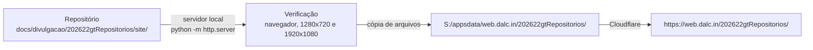

# Plano de implementação

## 1. Missão

Construir a apresentação descrita no [roteiro](./roteiro.md) e publicar em `https://web.dalc.in/202622gtRepositorios/`.

- Prazo real: a apresentação é em 2026-11-26.
- Uma sessão. Sem novas decisões de conteúdo: o roteiro decide o conteúdo, este plano decide a técnica.
- Se uma regra deste plano e o roteiro entram em conflito, o roteiro vence no conteúdo e este plano vence na técnica. Em dúvida real, perguntar ao autor. Uma pergunta por vez.

## 2. Leitura obrigatória, nesta ordem

1. `AGENTS.md` do repositório e `CONTEXT.md` (glossário).
2. [roteiro](./roteiro.md): inteiro.
3. Este plano: inteiro.
4. [plataforma](./pesquisa/plataforma.md): seções 1.2, 1.3 e 4. As seções 3 e 5 são históricas; as decisões estão na seção 3 deste plano.
5. [exemplos de perguntas](./pesquisa/chatbb-perguntas.md), [prompt final](./pesquisa/chatbb-prompt-final.md) e [números no auge](./pesquisa/numeros-auge.md): dados da parada 4.
6. Sob demanda: [histórico](./pesquisa/historico.md) e [ingestão](./pesquisa/ingestao.md), para conferir uma citação.

Skills a carregar antes de escrever código: `frontend-design` (direção visual) e `ponytail` (diff mínimo).

## 3. Decisões fechadas

| Tema | Decisão |
|---|---|
| Formato | Página única. Tela-hub = trilha na floresta em perfil de elevação. 6 paradas em tela cheia. Fecho no hub |
| Stack | Nível 1 do `AGENTS.md`: HTML + JS (ES modules) + CSS. Sem build, sem npm, sem framework, sem CDN |
| Bibliotecas | Nenhuma biblioteca de JS. Só Boxicons vendorizado (CSS + woff2) |
| Gráficos | SVG e HTML próprios. Sem Mermaid na página. Mermaid só nos `.md` |
| Dados | Um módulo `dados.js` com todo o conteúdo. Sem `fetch`, sem banco, sem DuckDB-WASM |
| ChatBB | Só perguntas. Sem respostas, sem chat simulado, sem chamada a LLM |
| Tema | Claro e escuro, com botão. Padrão: `prefers-color-scheme` |
| Idioma | pt-BR |
| Acesso | Público. Sem Cloudflare Access |
| Offline | Service worker com cache do shell |
| Rastreamento | Sem Matomo. Nenhuma requisição externa |
| Licença no rodapé | Conteúdo: CC BY 4.0. Código do projeto: GPL v3. DOI `10.5281/zenodo.18668804` |
| Notas do apresentador | Fora da página. As falas ficam no roteiro |

Fora de escopo: portar fontes temáticas para o DuckDB; recuperar respostas do ChatBB; corrigir o README do projeto (514 → 785 fontes); mudar nginx, Cloudflare ou outras pastas do web root.

## 4. Onde o código vive e como se publica



- **Fonte da verdade:** `docs/divulgacao/202622gtRepositorios/site/`, no `main`.
- **Publicação:** copiar o conteúdo de `site/` para `S:/appsdata/web.dalc.in/202622gtRepositorios/`. A pasta do web root é o site ao vivo. Escrever nela publica na hora.
- **Regra:** nunca editar direto no web root. Nunca tocar em outra pasta do web root.
- A pasta `S:/appsdata/web.dalc.in/202622gtRepositorios/` não existe em 2026-11-14. Criar na fase 7.

## 5. Arquivos

```
docs/divulgacao/202622gtRepositorios/
├── site/
│   ├── index.html
│   ├── estilo.css
│   ├── tema.js            # script clássico, bloqueante: define data-theme antes da pintura
│   ├── app.js             # módulo: estado, rotas por hash, teclado, tema, registro do SW
│   ├── trilha.js          # módulo: SVG do hub, caminhante, faixa de selos
│   ├── paradas.js         # módulo: desenha cada parada e as interações
│   ├── dados.js           # módulo: todo o conteúdo do roteiro, como dados
│   ├── sw.js
│   ├── manifest.json
│   ├── icone.svg
│   └── vendor/boxicons/   # boxicons.min.css, boxicons.woff2, LICENSE
└── verificar-dados.js     # checagem de dados.js; não vai para o web root
```

Dez arquivos próprios. Não criar mais sem motivo.

Regras de nome (o WAF e o nginx bloqueiam por trecho do caminho):

- Só ASCII minúsculo e hífen.
- Módulos com extensão `.js`. Nunca `.mjs`.
- Nunca usar no nome: `.db`, `.log`, `.ini`, `.conf`, `.bak`, `.zip`, `.sqlite`. Exemplos proibidos: `app.config.js`, `x.init.js`, `site.logo.svg`.
- Nenhuma pasta com ponto inicial.

## 6. Arquitetura

### 6.1 Estado e rotas

Estado mínimo: `tela` e `passo`.

| Hash | Tela |
|---|---|
| `#/` | Hub, abertura |
| `#/1` a `#/6` | Paradas 1 a 6 |
| `#/4/2` | Parada 4, passo 2 (o mesmo padrão vale para toda parada com passos) |
| `#/fecho` | Hub, fecho |

- A URL é a única fonte do estado. `hashchange` redesenha. Recarregar a página volta ao mesmo ponto.
- Não usar `history.pushState` com caminhos limpos: o `try_files` do nginx não resolve.

### 6.2 Sequência linear

A apresentação é uma lista ordenada de passos: hub → 1 (passos) → 2 (passos) → … → 6 (passos) → fecho (passos). "Avançar" vai para o próximo passo da lista. O apresentador conduz tudo com uma tecla.

### 6.3 Teclado e ponteiro

| Tecla | Ação |
|---|---|
| `→`, `Espaço`, `PageDown`, `Enter` | Próximo passo |
| `←`, `PageUp` | Passo anterior |
| `H`, `Esc` | Hub, com o caminhante na parada atual |
| `1` a `6` | Ir para a parada |
| `T` | Alternar tema |
| `F` | Tela cheia |

- Clique em uma parada do hub abre a parada. Clique nos controles de cada interação funciona como no roteiro.
- Na parada 4.3, o clique em uma pergunta acende o grafo. A tecla "próximo" percorre as 4 perguntas da ordem do roteiro e depois sai da parada.
- Dois botões visíveis e discretos, "anterior" e "próximo", para quem lê sozinho. Alvo de toque ≥ 44 px.

### 6.4 Movimento: regra do Meet

O Meet comprime o compartilhamento de tela. Movimento contínuo vira borrão.

- Toda transição é discreta e dura no máximo 300 ms.
- Proibido: parallax, animação em laço, partículas, efeito de digitação, animação ligada à rolagem.
- Permitido: troca de opacidade, mudança de cor, deslocamento curto do caminhante entre duas paradas.
- `@media (prefers-reduced-motion: reduce)`: sem transição.
- Sem rolagem dentro das telas. Cada tela cabe em 16:9.

### 6.5 Leitura no Meet

- Projetar para 1280×720 e conferir em 1920×1080.
- Corpo de texto: no mínimo 2,2 % da altura da janela (`clamp()` com `vh`). Rótulos e evidência: no mínimo 1,6 %.
- Contraste AA nos dois temas. Não depender só de cor: as coleções acesas no grafo ganham também borda grossa e ícone.
- Máximo de 40 palavras de texto corrido por estado de tela. O resto está na fala.

### 6.6 `dados.js`

Um `export const` por bloco. Estrutura mínima:

```js
export const fontes = [ /* 5 selos: id, rotulo, icone */ ];
export const telas = [
  { id: "hub", titulo, subtitulo, assinatura, selos: [] },
  { id: "1", titulo, marco, minutos: 2.5, mensagem, citacoes: [], passos: [], ingestao: [], evidencia: [], selos: ["especies","ocorrencias"] },
  // ...
  { id: "fecho", minutos: 1.5, /* ... */ },
];
export const auge = { data: "2025-08-21", especies: { total: 196314, animalia: 134582, plantae: 53264, fungi: 8468 }, ocorrencias: { total: 8984456, plantae: 5659707, animalia: 3084163, fungi: 240586 }, tematicas: [ /* 4: rotulo, numero */ ], nota };
export const prompt = { linhas: 204, versao: "2026-02-18", blocos: [ /* 7: titulo, resumo, trecho */ ], ligacoes: [ /* 5 arestas: de, para, chave */ ] };
export const perguntas = [ /* 14: texto literal, colecoes: [], destaque: 1..4 | null */ ];
```

- Todo texto de tela vem deste módulo. Nenhum texto de conteúdo em `paradas.js` nem em `index.html`.
- Copiar citações e números do roteiro sem alterar. Regras de conteúdo: roteiro, seção 6.
- Desenhar com `textContent` e criação de elementos. Sem `innerHTML` com dados.

### 6.7 Tema

- `tema.js` (script clássico, no `<head>`, bloqueante): lê `localStorage`, senão `prefers-color-scheme`; grava `data-theme` em `<html>`.
- Cores só por variáveis CSS em `:root[data-theme="light"]` e `:root[data-theme="dark"]`. Declarar `color-scheme`.
- Modelo no web root: `faunabr/comum/base.css` e `gene/index.html` (linha 7). Ler, não copiar a pasta.

### 6.8 Segurança

- Sem segredo, sem entrada de usuário, sem requisição externa.
- `<meta http-equiv="Content-Security-Policy" content="default-src 'self'; img-src 'self' data:; font-src 'self'; style-src 'self'; script-src 'self'; base-uri 'none'; form-action 'none'">`.
- Por causa da CSP: nenhum script inline, nenhum `style=""` inline. Posições do SVG por atributos e classes.
- `<meta name="referrer" content="no-referrer">`.

### 6.9 Offline

- `sw.js`: cache do shell, estratégia cache-first, lista explícita de arquivos, todos com caminho relativo (`./`). Modelo: `S:/appsdata/web.dalc.in/dashboards/asilo/sw.js`. Não usar `news/sw.js` (caminhos absolutos).
- Nome do cache com versão. O `activate` apaga caches antigos.
- `manifest.json`: `start_url: "./"`, `scope: "./"`, ícone `icone.svg`.

### 6.10 Cache do Cloudflare

O Cloudflare guarda `.js` e `.css` por 4 horas.

- Uma constante `VERSAO` (exemplo: `"2026-11-20a"`). Ela aparece em: `?v=` de todo `<script>` e `<link>` do `index.html`, `?v=` de todo `import` entre módulos, nome do cache do `sw.js`.
- A cada publicação, trocar `VERSAO` em todos os pontos. `verificar-dados.js` confere se todos os pontos têm o mesmo valor.

## 7. Especificação das telas

Conteúdo: roteiro, seções 4 e 5. Aqui só a forma.

### 7.1 Hub (abertura e fecho)

- Um `<svg viewBox="0 0 1600 900">` que ocupa a janela, com `<title>` e `<desc>`.
- Camadas, de trás para a frente: céu; serra distante; floresta média; trilha; floresta próxima (silhuetas de copas em primeiro plano, só nas bordas); névoa à direita.
- A trilha é um `<path>`. Posicionar paradas e caminhante com `getPointAtLength()`.

Altitude das paradas (0 = base, 100 = cume). O eixo x é a ordem, não o tempo:

| Ponto | x (%) | Altitude | Marca |
|---|---|---|---|
| Início da trilha | 4 | 10 | Placa |
| Parada 1 | 16 | 25 | Marco |
| Parada 2 | 29 | 45 | Marco |
| Parada 3 | 42 | 68 | Marco |
| Parada 4 (mirante) | 55 | 95 | Mirante: plataforma com guarda-corpo. Maior que as outras |
| Fim do trecho on-line | 66 | 90 | Trilha tracejada e apagada que termina. Rótulo "trecho on-line encerrado · 2026-05" |
| Parada 5 | 68 | 60 | Marco na descida |
| Parada 6 (clareira) | 81 | 28 | Clareira com riacho. Nascentes pequenas na encosta |
| Névoa | 92–100 | 30–36 | 3 marcos em contorno + 1 sem nome |

- Rótulos de fase no céu: "Fase 1 · on-line" sobre a subida; "Fase 2 · dados locais" sobre o vale.
- Cada parada: número, título curto, data. Estado atual com `aria-current="step"`.
- Faixa de selos na base, fora do SVG: 5 selos com ícone Boxicons e rótulo. Estados: apagado, aceso, contorno ("a caminho").
- Fecho: o mesmo SVG. Caminhante na clareira. Três passos acendem os marcos da névoa. Depois aparecem a frase final e o rodapé.
- Hub em modo `H` (no meio da apresentação): igual à abertura, sem título grande, com o caminhante na parada atual.

### 7.2 Estrutura comum das paradas

Grade fixa em 16:9:

- Topo: mini-trilha (linha fina com 6 pontos, o atual destacado), número, título, marco.
- Centro-esquerda (40 %): mensagem única e citações do passo atual.
- Centro-direita (60 %): a interação.
- Base: faixa "Ingestão nesta época" (até 3 itens curtos por passo), faixa de selos, evidência.

A parada 4 troca o fundo para a paleta "céu aberto". As outras usam a paleta de sub-bosque.

### 7.3 Interações

| Parada | Interação | Forma | Passos |
|---|---|---|---|
| 1 | A trilha alarga | Três faixas que se somam (Flora, + Fauna, + Ocorrências). Ao lado, figura que alterna "tabelas com JOINs" e "1 documento JSON". Abertura com o diagrama de 2 nós de 2022 | 4 |
| 2 | Placas da interface | Seis placas de trilha em um poste. A placa ativa mostra descrição e data | 7 |
| 3 | Nascentes fora do IPT | `taxa` e `occurrences` no centro; 5 cartões em volta. O cartão ativo acende a aresta e mostra origem, número, chave e limite | 6 |
| 4.0 | A base no auge | Dois números grandes (espécies, ocorrências) com o detalhe por reino abaixo; uma linha com as 4 fontes temáticas; nota fixa de data e critério. Números com separador de milhar pt-BR | 1 |
| 4.1 | Como funcionava | Fluxo horizontal de 4 elos, acesos um a um | 4 |
| 4.2 | 7 blocos do prompt | Sete cartões em linha. O ativo abre resumo e trecho literal. O bloco 6 mostra o grafo de ligações (6 nós, 5 arestas rotuladas). No fim, as 3 lições | 9 |
| 4.3 | Pergunte à base | Lista das 14 perguntas à esquerda; grafo de coleções à direita. A pergunta ativa acende os nós e as arestas dela | 5 |
| 5 | Antes ↔ depois | Seletor de 2 estados sobre uma tabela de 6 linhas. No estado "depois", 5 placas de ADR. Linha honesta fixa no rodapé | 3 |
| 6 | Siga um registro | Passo-a-passo de 8 etapas ao longo de um riacho; painel "antes → depois" do registro. Depois, o painel de grafias | 10 |
| Fecho | Próximas estações | Marcos da névoa acendem um a um | 4 |

- O grafo de coleções é o mesmo componente em 4.2 e 4.3. Posições fixas, escritas à mão. Sem biblioteca de grafos.
- Em 4.3, a nota fixa "Caminho previsto pelas regras do prompt" fica sempre visível.
- Em 4.0, a nota fixa de data e critério fica sempre visível. Os dois números são o maior texto de toda a apresentação.
- Em 6, o rótulo "Exemplos dos testes do código" fica sempre visível no painel "antes → depois".

### 7.4 Direção visual

Decidir com a skill `frontend-design`, dentro destes limites:

- Tom: guia de campo e caderno de trilha. Não corporativo, não infantil.
- Tema claro: papel e verdes de sub-bosque. Tema escuro: floresta à noite, com o mirante como ponto de luz.
- Uma cor de destaque para "aceso" (selos, arestas, parada atual), igual nas 8 telas.
- Tipografia: pilha de fontes do sistema. Uma serifada para títulos e citações, uma sem serifa para rótulos, uma monoespaçada para campos. Só vendorizar fonte (woff2 + licença OFL) se a pilha do sistema falhar no Windows.
- Ícones: só Boxicons.
- Sem imagem raster. Sem foto. Sem emoji.

### 7.5 Acessibilidade

- Navegação completa por teclado. `:focus-visible` evidente.
- Uma região `aria-live="polite"` anuncia "Parada N: título, passo X de Y".
- SVG com `<title>` e `<desc>`. Elementos decorativos com `aria-hidden="true"`.
- Sem JavaScript: `<noscript>` com título, tese e link para o roteiro no GitHub.

## 8. Fases

Seguir na ordem. Não rodar verificação no meio de uma fase.

| Fase | Entrega | Aceite |
|---|---|---|
| 0 | Leitura (seção 2). Skills carregadas | — |
| 1 | `index.html`, `estilo.css` (grade, variáveis, 2 temas), `tema.js`, `app.js` (rotas, sequência, teclado) com telas vazias | Percorrer hub → 6 → fecho e voltar só com o teclado. Recarregar mantém a tela. `T` troca o tema sem piscar |
| 2 | `dados.js` completo + `verificar-dados.js` | `node docs/divulgacao/202622gtRepositorios/verificar-dados.js` termina com código 0 |
| 3 | `trilha.js`: hub, caminhante, selos | O hub mostra subida, mirante, trecho encerrado, descida, clareira e névoa. Os selos seguem a tabela do roteiro, seção 4 |
| 4 | `paradas.js`: paradas 1, 2, 3, 5, 6 | Cada interação cumpre a tabela 7.3. Nenhuma tela rola em 1280×720 |
| 5 | `paradas.js`: parada 4 (4.0, 4.1, 4.2, 4.3) | Números do auge iguais aos do roteiro. 7 blocos, grafo com 5 arestas, 14 perguntas, 4 destaques na ordem do roteiro. Nenhuma resposta na tela |
| 6 | Boxicons vendorizado, `sw.js`, `manifest.json`, `icone.svg`, CSP | Console sem erro de CSP. Aba Rede sem requisição externa. Com o servidor parado, a página recarrega do cache |
| 7 | Verificação (seção 9), publicação (seção 10) | Seções 9 e 10 completas |
| 8 | `log.md` atualizado. Commit no `main` | Commit feito |

Boxicons: baixar uma vez de `https://cdn.jsdelivr.net/npm/boxicons@2.1.4/css/boxicons.min.css` e `.../fonts/boxicons.woff2`, mais a licença. Ajustar o `@font-face` para o woff2 local. Descartar `.eot`, `.ttf`, `.woff`, `.svg`. Não usar o pacote npm.

## 9. Verificação

### 9.1 `verificar-dados.js`

Uma checagem, sem framework, com `node:assert`. Importa `./site/dados.js` e lê os arquivos do site. Falha se:

- a soma de `minutos` das telas ≠ 20;
- não há exatamente 6 paradas, 7 blocos de prompt, 5 ligações, 14 perguntas, 4 destaques (1 a 4, sem repetição);
- em `auge`, a soma dos três reinos difere do total, em espécies ou em ocorrências;
- uma pergunta ou uma ligação cita uma coleção que não existe no grafo;
- uma parada cita um selo que não existe em `fontes`;
- os selos por tela diferem da tabela do roteiro, seção 4;
- `VERSAO` não é igual em `index.html`, nos `import` e no `sw.js`;
- a lista de arquivos do `sw.js` difere dos arquivos de `site/`;
- algum arquivo de `site/` tem nome proibido (seção 5).

### 9.2 Navegador

Servir com `python -m http.server 8765 --directory docs/divulgacao/202622gtRepositorios/site` e abrir `http://localhost:8765/`.

1. Percorrer todos os passos com `→`, nos dois temas, em 1280×720 e 1920×1080.
2. Comparar cada tela com o roteiro: citações literais, números, rótulos obrigatórios.
3. Conferir: sem rolagem, sem texto cortado, sem sobreposição, foco visível.
4. Console sem erros. Aba Rede: só `localhost`.
5. Ativar "reduzir movimento" no sistema: sem transições.
6. Parar o servidor e recarregar: a página abre do cache.
7. Screenshots de conferência: só em `C:\Users\EDalcin\Desktop\OMPtemp`. Nunca no repositório, nunca no web root.

### 9.3 Ensaio de tempo

Contar os passos por tela e comparar com os tempos do roteiro (seção 3). Uma tela com mais de 1 passo a cada 15 segundos está densa demais: fundir passos, não cortar conteúdo decidido.

## 10. Publicação

1. Trocar `VERSAO`. Rodar `verificar-dados.js`.
2. Criar `S:/appsdata/web.dalc.in/202622gtRepositorios/`. Copiar o conteúdo de `site/`. Não copiar `verificar-dados.js` nem arquivos `.md`.
3. Abrir `https://web.dalc.in/202622gtRepositorios/?x=<timestamp>`.
4. Conferir na aba Rede: todo arquivo com status 200. Um 403 indica nome bloqueado (seção 5). Um `.js` antigo indica `VERSAO` não trocada.
5. Repetir a seção 9.2, itens 1 a 4, na URL pública.
6. Entregar ao autor: URL, lista de teclas e contagem de passos por tela.

## 11. Riscos

| Risco | Sinal | Resposta |
|---|---|---|
| Cache de 4 h do Cloudflare serve JS antigo | A página pública difere da local | Trocar `VERSAO` em todos os pontos |
| Nome de arquivo bloqueado | 403 na aba Rede | Renomear conforme a seção 5 |
| Service worker prende versão antiga | Mudança não aparece depois de recarregar | Versão no nome do cache; `activate` limpa |
| Fonte do Boxicons não carrega | Quadrados no lugar dos ícones | Corrigir a URL do `@font-face`; conferir `font-src 'self'` |
| Texto pequeno no Meet | Ilegível em 1280×720 | Aplicar a seção 6.5; cortar texto de tela, nunca a fala |
| Hub bonito e ilegível | Paradas e trilha se perdem na floresta | Primeiro plano só nas bordas; a trilha tem o maior contraste da tela |
| Escopo cresce | Chat simulado, respostas, animação | Recusar. Ver a seção 3 |

## 12. Pendências do autor

As mesmas do roteiro, seção 7. Nenhuma bloqueia. Usar os padrões indicados lá.

## 13. Prompt inicial sugerido para a sessão de implementação

```text
Implemente a apresentação descrita em docs/divulgacao/202622gtRepositorios/.
Leia, nesta ordem: plano-implementacao.md (seção 2 lista a leitura), roteiro.md.
O roteiro decide o conteúdo. O plano decide a técnica. Siga as fases da seção 8.
Não tome decisões de conteúdo. Em dúvida real, pergunte: uma pergunta por vez.
Código-fonte em docs/divulgacao/202622gtRepositorios/site/. Publique no fim,
em S:/appsdata/web.dalc.in/202622gtRepositorios/, conforme a seção 10.
```
