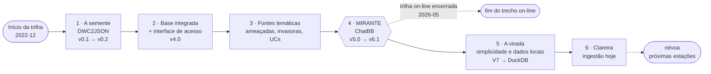
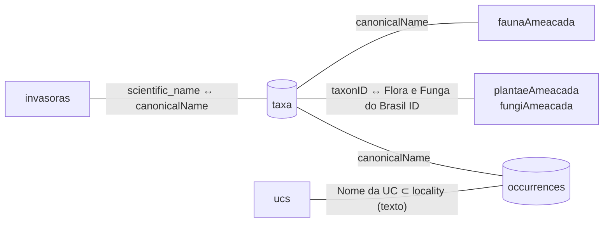

# Roteiro — A trilha da base integrada

> As decisões da seção 2 são do autor. O texto das falas e das telas é proposta deste roteiro e ainda não foi revisto pelo autor.

## 1. Ficha

| Item | Valor |
|---|---|
| Ocasião | Reunião do GT Repositórios |
| Data | 2026-11-26 |
| Meio | Remoto, Google Meet, compartilhamento de tela |
| Duração | 20 minutos |
| Limite | No máximo 10 slides. Este roteiro usa 8 telas: hub, 6 paradas, fecho |
| Público | Pares técnicos: gestores e curadores de repositórios de dados. Conhecem Darwin Core e IPT |
| Apresentador | Eduardo Dalcin |
| Idioma | pt-BR |
| Uso posterior | O mesmo link serve para leitura autoguiada |

**Tese.** Uma base integrada da biodiversidade brasileira é infraestrutura. O valor aparece quando se cruzam fontes: espécies, ocorrências, espécies ameaçadas, espécies invasoras e Unidades de Conservação.

**Frase que o GT deve lembrar** (proposta do roteiro). "Integrar é o que gera informação. Hospedar não é."

## 2. Decisões do autor

Decisões tomadas pelo autor em 2026-11-14.[^autor] Não alterar sem nova consulta.

| # | Pergunta | Decisão |
|---|---|---|
| 1 | Público e ocasião | Pares técnicos. Remoto, Google Meet, 26/11, 20 minutos, máximo de 10 slides |
| 2 | Tese | Base integrada como infraestrutura. O valor é cruzar fontes |
| 3 | A versão atual não tem as fontes temáticas. Como tratar? | Ver a declaração literal abaixo |
| 4 | Formato | Tela-hub que representa a linha do tempo dos releases como uma **trilha na floresta**. Cada parada abre uma cena em tela cheia com uma interação. Setas avançam. Sem "mapa de metrô" |
| 5 | Paradas | 6 paradas + hub + fecho. A ingestão tem parada própria |
| 6 | Respostas do ChatBB | Mostrar somente exemplos de perguntas que foram feitas. Sem respostas |
| 7 | Direção visual | Perfil de elevação: a trilha sobe até um mirante (ChatBB), desce para uma clareira (dados locais) e segue para a névoa |
| 8 | Mapa wayfinder no GitHub | Não. Sem névoa restante. Roteiro e plano escritos direto |

Instruções dadas durante a sessão:

- Destacar as perguntas feitas no chat com a base de dados toda integrada.
- A versão com o chat é o **auge da primeira fase**. Destacar. Depois o projeto optou pela simplicidade e por dados locais.
- Destacar o prompt final do chat. Fazer um resumo didático do prompt, na última versão.
- No auge, mostrar o número de registros na base de dados, para espécies e ocorrências.

**Declaração do autor sobre a virada** (grafia corrigida, sentido intacto; usar na parada 5; pode ser encurtada, não pode mudar de sentido):

> A versão foi uma refatoração drástica. O que era uma ferramenta on-line voltou-se para a criação de um conjunto de dados local e "stand-alone", para uso individual e local em análise de dados de biodiversidade. O foco era eliminar a responsabilidade de ter que hospedar ferramentas e focar no que era importante: a construção de um conjunto de dados integrado e útil para gerar informações relevantes. Neste processo de migração de plataforma de banco de dados, focamos, nesta versão, em conjuntos de dados facilmente acessíveis e já padronizados, disponíveis em IPTs. Iniciamos também com dados de ocorrências e espécies. Nas próximas versões vamos integrar outras fontes de dados, incluindo as que foram integradas em releases anteriores. Ainda estamos no processo de migração da proposta para a nova plataforma de bancos de dados e ainda não tivemos oportunidade de chegar nas fontes temáticas.

## 3. Arco narrativo

Duas fases e uma virada.

- **Fase 1, on-line (2022-12 → 2026-02).** A trilha sobe. Um conversor vira uma base. A base ganha interface. A base ganha fontes temáticas. O auge é o ChatBB: perguntas em português sobre a base toda integrada.
- **Virada (2026-05 → 2026-09).** Refatoração drástica. O projeto deixa de hospedar ferramentas.
- **Fase 2, dados locais (2026-09 → hoje).** Um script, um arquivo DuckDB, dados harmonizados em Darwin Core. As fontes temáticas voltam nas próximas versões.

### Tempos

| Tela | Título | Marco | Tempo | Acumulado |
|---|---|---|---|---|
| Hub | A trilha (abertura) | 2022 → 2026 | 1:00 | 1:00 |
| 1 | A semente: DWC2JSON | 2022-12 → v0.2 (2024-03) | 2:30 | 3:30 |
| 2 | Base de Dados Integrada + interface de acesso | v4.0 (2025-04) | 2:30 | 6:00 |
| 3 | Fontes temáticas | 2024-01 → 2025-05 | 2:00 | 8:00 |
| 4 | O mirante: ChatBB | v5.0 → v6.1 (2025-05 → 2026-02) | 5:00 | 13:00 |
| 5 | A virada: simplicidade e dados locais | V7 → DuckDB (2026-05 → 2026-09) | 2:30 | 15:30 |
| 6 | Ingestão hoje | HEAD (2026-10) | 3:00 | 18:30 |
| Fecho | Próximas estações (volta ao hub) | futuro | 1:30 | 20:00 |

## 4. Tela-hub: a trilha na floresta

**Imagem.** Perfil lateral de uma serra coberta de floresta, em camadas de silhuetas. Uma trilha cruza a tela da esquerda para a direita. A altitude tem significado.

| Elemento | Posição | Significado |
|---|---|---|
| Placa "Início da trilha" | esquerda, baixo | Primeiro commit, 2022-12-09 |
| Paradas 1, 2, 3 | subida | Fase 1: cada parada integra mais |
| Mirante (parada 4) | cume | ChatBB, auge da fase 1 |
| Trecho tracejado que continua no alto e termina | depois do cume | Trilha on-line encerrada em 2026-05 |
| Descida | depois do cume | A virada (parada 5) |
| Clareira com riacho (parada 6) | vale, direita | Dados locais. O riacho nasce em muitas nascentes: as Fontes IPT |
| Névoa com 3 marcos apagados | extrema direita | Próximas estações: ameaçadas, invasoras, UCs |
| Caminhante (marcador) | sobre a trilha | Posição atual da apresentação |

**Faixa de fontes.** Abaixo da trilha, uma faixa com 5 selos: Espécies · Ocorrências · Ameaçadas · Invasoras · UCs. Em cada parada, os selos das fontes integradas naquela época ficam acesos. A faixa mostra a tese sem palavras: 1 selo, depois 2, depois 5 no mirante, depois 2 na clareira, e 3 selos apagados na névoa.

| Tela | Selos acesos |
|---|---|
| Hub (abertura) | nenhum |
| 1 | Espécies, Ocorrências |
| 2 | Espécies, Ocorrências |
| 3 | os 5 |
| 4 | os 5 |
| 5 | Espécies, Ocorrências |
| 6 | Espécies, Ocorrências |
| Fecho | Espécies, Ocorrências acesos; Ameaçadas, Invasoras, UCs em contorno ("a caminho") |

**Texto na abertura.**

- Título: "A trilha da base integrada"
- Subtítulo: "Biodiversidade.Online: de DWC2JSON ao DuckDB, 2022–2026"
- Assinatura: "Eduardo Dalcin · Henrique Pinheiro" · "GT Repositórios · 26/11/2026"

**Fala (1:00).** "Vou contar quatro anos de um projeto em 20 minutos, como uma caminhada. A trilha tem duas fases. Na primeira, subimos: de um conversor de Darwin Core para JSON até um chat que respondia perguntas sobre uma base toda integrada. Na segunda, descemos por escolha: trocamos a ferramenta on-line por um conjunto de dados local. A pergunta que guia a caminhada é uma só: o que acontece quando se cruzam fontes."

## 5. Paradas

Anatomia fixa de cada parada:

1. **Cabeçalho**: número, título, marco e data.
2. **Mensagem única**: uma frase.
3. **Interação**: um controle, operado pelo apresentador.
4. **Faixa "Ingestão nesta época"**: como os dados entravam.
5. **Evidência**: tag, commit ou arquivo. Texto pequeno, no rodapé.

Citações entre aspas são literais. Não editar.

### Parada 1 — A semente: DWC2JSON

- **Marco.** 2022-12-09 (primeiro commit) → v0.1-alpha (2024-01-04) → v0.2-alpha (2024-03-05).
- **Tempo.** 2:30.
- **Mensagem única.** Um conversor genérico de Darwin Core Archive para JSON aceitou qualquer "core". O escopo cresceu sozinho.

**Na tela.**

- O primeiro README do repositório, um diagrama de dois nós: "Pega DwC do IPT" → "Converte para JSON" (2022-12-09).
- Objetivo da v0.1: "Criar uma ferramenta livre, gratuita e de código que ofereça os dados publicados pela Flora e Funga do Brasil em formato Darwin Core Archive no IPT, em formato JSON".
- O problema: a estrutura relacional do DwC-A "exige do {usuário, analista, cientista de dados, pesquisador etc} um esforço adicional para relacionar e integrar as diferentes tabelas".
- A virada de escopo (v0.2): "o código implementado era genérico o suficiente para reconhecer e automatizar a conversão de diferentes 'cores'".

**Interação: "a trilha alarga".** Três passos, um por tecla.

| Passo | Mostra | Número |
|---|---|---|
| 1 | Flora e Funga do Brasil | "mais de 135.000 nomes científicos" (v0.1) |
| 2 | + Catálogo Taxonômico da Fauna do Brasil | "cerca de 278 mil nomes de espécie" (v0.2) |
| 3 | + Ocorrências | "cerca de 12 milhões de fichas de ocorrências, provenientes de 458 recursos publicados em 10 diferentes IPTs" (v0.2) |

Em cada passo, a figura troca de "1 core + N extensões, com JOINs" para "1 documento JSON".

**Ingestão nesta época.**

- Seleção: só táxons-folha (`ESPECIE`, `VARIEDADE`, `FORMA`, `SUB_ESPECIE`).
- `canonicalName` calculado. Pula a Fonte IPT se a versão publicada não mudou.
- Seleção de fontes: "matriz de seleção" para herbários publicados em mais de um IPT. Ordem: JABOT > REFLORA > speciesLink. Lista de 124 siglas.
- Motor: Deno + TypeScript → MongoDB. Atualização por GitHub Actions. "todo o banco de dados é atualizado em poucos minutos, apenas clicando nas 'actions'".

**Fala.** "Tudo começou com um incômodo: o Darwin Core Archive da Flora é relacional, e toda análise começa com JOINs. Fizemos um conversor para JSON, só para a Flora. O parser saiu genérico. Então a Fauna entrou. Depois as ocorrências. Em março de 2024 havia 278 mil nomes e 12 milhões de registros, de 458 recursos em 10 IPTs. E já havia uma decisão de curadoria: o mesmo herbário aparece em mais de um IPT, e era preciso escolher uma origem."

**Evidência.** `da275a7:README.md` · `v0.1-alpha:README.md` · `v0.2-alpha:README.md` · `v0.2-alpha:referencias/matrizSelecaoFontes.md`.[^historico]

**Cuidado.** O README narra Flora → Fauna → ocorrências. Os commits mostram ocorrências (2023-11-05) antes da fauna (2023-12-13). Seguir a ordem do README e não mostrar datas por passo.

### Parada 2 — Base de Dados Integrada + interface de acesso

- **Marco.** v4.0, 2025-04-21. Nome novo: "Base de Dados Integrada da Biodiversidade Brasileira (DwC2JSON V4.0)".
- **Tempo.** 2:30.
- **Mensagem única.** O produto deixou de ser o conversor. O produto passou a ser a base. A interface tornou a base visível.

**Na tela.**

- Release v4.0: "Criação de uma base de dados em JSON da biodiversidade brasileira, integrando dados taxonômicos da flora, fungos e fauna com dados de ocorrência."
- Números (README v4.0): "mais de 290 mil nomes" · "15 diferentes IPTs" · "493 conjuntos de dados de ocorrências".
- A promessa que guia as próximas paradas (README v4.0): "possibilitar a agregação de outros conjuntos de dados relevantes, como dados de espécies invasoras, dados de avaliação de risco de extinção".

**Interação: "placas da interface".** Seis placas de trilha. Cada placa abre uma linha de descrição e a data de chegada.

| Placa | Chegou | O que fazia |
|---|---|---|
| Busca e ficha de espécie | 2023-04 | Busca por gênero ou espécie; ficha do táxon |
| API | 2023-04 (OpenAPI em 2024-07) | Táxon em JSON; ocorrências por espécie e por proximidade |
| Mapa de ocorrências | 2023-11 | Ocorrências por táxon; depois filtros e mapa por estado |
| Dashboard | 2024-06 | Contagens da base; depois ameaçadas e invasoras |
| Árvore taxonômica | 2025-03 | Navegação pela hierarquia |
| Calendário fenológico | 2025-09 | Floração por mês, derivada das ocorrências |

Endereços da época, como texto e não como link: `dwc2json.dalc.in` (v4.0) e `biodiversidade.online` (v6.0).

**Ingestão nesta época.**

- Três "actions" todo domingo: flora, fauna e ocorrências. "todo o domingo 3 'actions' de atualização da base de dados no MongoDB são acionadas". Agenda criada em 2024-03-27.
- Campos derivados: `flatScientificName` e `geoPoint` (só com coordenadas válidas).
- Curadoria contra duplicação mantida: "matriz de seleção".

**Fala.** "Em 2025 o nome mudou, e o nome diz tudo: Base de Dados Integrada. O produto eram dois conjuntos de dados, taxa e ocorrências, atualizados todo domingo. As interfaces eram prova de conceito: busca, API, mapa, dashboard. E o README já anunciava o passo seguinte: agregar invasoras e risco de extinção. Guardem essa frase."

**Evidência.** `gh release view v4.0` · `v4.0:README.md` · `v4.0:atualizacao.md` · tabela de interface em `pesquisa/historico.md` §3.[^historico]

### Parada 3 — Fontes temáticas

- **Marco.** 2024-01-13 (primeira lista de ameaçadas) → 2025-05 (cinco coleções de apoio).
- **Tempo.** 2:00.
- **Mensagem única.** As fontes temáticas não vêm de IPT nem em Darwin Core. Elas entram por CSV e se ligam por nome. É aqui que a base começa a responder perguntas de conservação.

**Interação: "nascentes fora do IPT".** No centro, `taxa` e `ocorrências`. Em volta, 5 cartões. Um clique no cartão acende a linha de ligação e mostra origem, formato, chave e limite.

| Fonte | Origem | Número | Chave de ligação | Limite |
|---|---|---|---|---|
| Espécies ameaçadas (flora e fauna) | Portaria MMA nº 148, de 7 de junho de 2022 | 4.467 espécies: 3.209 Plantae, 1.258 Animalia | `canonicalName` | Entrou em 2024-01; substituída em 2025-05 |
| Fauna ameaçada | MMA, Lista de Espécies Ameaçadas 2021 | 1.407 linhas | `canonicalName` | O arquivo tem linhas de nota editorial |
| Flora e fungos ameaçados | CNCFlora/JBRJ, avaliações até 2022 | 9.444 espécies avaliadas: 9.420 plantas, 24 fungos | `taxonID` ↔ "Flora e Funga do Brasil ID" | Única ligação por identificador |
| Espécies invasoras | Instituto Hórus | 485 espécies: 273 animais, 212 plantas | `scientific_name` ↔ `canonicalName` | Cerca de 30 campos: impactos, controle, vetores |
| Unidades de Conservação | CNUC/MMA, até março de 2025 | 3.185 UCs: 1.316 estaduais, 1.091 federais, 778 municipais | "Nome da UC" como trecho de `locality` | Ligação textual, não espacial |

**Ingestão nesta época.**

- Formato: CSV de órgãos federais e do Instituto Hórus. Não é DwC-A.
- Carga das coleções de apoio: sem script no repositório até 2026-02 `[INFERÊNCIA: carga manual]`.
- 2026-02-18: loaders CSV e enriquecimento "in-place". `taxa` ganha `threatStatus` e `invasiveStatus`. `ocorrências` ganha `conservationUnits`.
- Primeira consulta que cruzou fontes: invasoras em Parques Nacionais, 2024-03-28.

**Fala.** "Aqui a trilha fica mais íngreme. Ameaçadas, invasoras e Unidades de Conservação não estão em IPT nem em Darwin Core. São planilhas do MMA, do CNCFlora, do Instituto Hórus, do CNUC. A ligação é quase sempre pelo nome da espécie. No caso das UCs, é pelo nome da unidade dentro do campo de localidade. É frágil, e nós sabíamos. Mas com cinco fontes na mesma base, uma pergunta nova se tornou possível."

**Evidência.** `pesquisa/ingestao.md` §2 (contagens feitas sobre os CSVs das tags) · [números no auge](./pesquisa/numeros-auge.md) (CNCFlora e invasoras) · commits `4bb3493`, `4db83ed`, `e348e3a`, `7a4c3e7`.[^ingestao]

### Parada 4 — O mirante: ChatBB

- **Marco.** v5.0 (2025-05-25) → v5.1/v5.2 (2025-07-12) → v6.0 "Biodiversidade.Online" (2025-09-22) → v6.1 (2026-02-17).
- **Tempo.** 5:00, em quatro passos: a base no auge (0:30), como funcionava (0:45), o prompt (2:00), as perguntas (1:45).
- **Mensagem única.** No mirante se vê tudo de uma vez: uma pergunta em português cruza cinco fontes. Quem fazia a integração era um texto de 204 linhas.
- **Tratamento visual.** É o auge. A tela muda de luz (céu aberto). Os 5 selos estão acesos.

#### Passo 4.0 — A base no auge (0:30)

**Na tela.** Primeira imagem do mirante. Dois números grandes e uma linha de fontes temáticas.

| Número grande | Rótulo | Detalhe por reino |
|---|---|---|
| **196.314** | espécies (nomes aceitos) | Animalia 134.582 · Plantae 53.264 · Fungi 8.468 |
| **8.984.456** | registros de ocorrência | Plantae 5.659.707 · Animalia 3.084.163 · Fungi 240.586 |

- Linha de fontes temáticas: "9.444 espécies com avaliação de risco da flora e dos fungos · 1.407 da fauna · 485 espécies invasoras · 3.185 Unidades de Conservação".
- Nota fixa: "Contagem do dashboard do projeto em 2025-08-21. Espécies: nomes aceitos de espécie e abaixo. Ocorrências: registros com reino informado."

**Fala.** "Este é o ponto mais alto da trilha. Em agosto de 2025 a base tinha 196 mil espécies com nome aceito e quase 9 milhões de registros de ocorrência. Ao lado delas, cerca de 9 mil e quatrocentas avaliações de risco da flora, mil e quatrocentas da fauna, 485 invasoras e mais de 3 mil Unidades de Conservação. Tudo no mesmo banco."

**Evidência.** `v6.0:packages/web/cache/dashboard-data.json` (`lastUpdated` 2025-08-21) · [números no auge](./pesquisa/numeros-auge.md).

#### Passo 4.1 — Como funcionava (0:45)

**Na tela.** Um fluxo de 4 elos, aceso um a um:

`pergunta em português` → `LLM (chave de API do usuário)` → `MCP: mongodb-mcp-server, somente leitura, ferramentas find e aggregate` → `7 coleções no MongoDB dwc2json`

- Release v5.0: a versão "se aproveita do protocolo MCP [...] para conectar a base de dados integrada da biodiversidade brasileira com a plataforma da OpenIA e criar o 'ChatBB - O Assistente Virtual Inteligente da Biodiversidade Brasileira'".
- Modelos: OpenAI `gpt-4.1-mini` na v5.0; Google Gemini na v5.1; no fim, OpenAI, Anthropic e Google.
- Primeiro commit do chat: 2025-05-14. Release: 2025-05-25. Onze dias.

**Fala.** "Em maio de 2025 o MongoDB publicou um servidor MCP. Em onze dias havia um chat. O usuário escrevia a pergunta. O modelo de linguagem escrevia as consultas. O MCP executava, só leitura, direto na base. Sem camada de API no meio."

#### Passo 4.2 — O prompt final (2:00)

**Na tela.** Título: "O prompt era o mapa da integração". Subtítulo: "204 linhas · última versão: 2026-02-18 · 44 commits de ajuste entre 2025-05 e 2025-12".

**Interação: "7 blocos do prompt".** Sete cartões na ordem do texto. Um clique abre o resumo e um trecho literal. O bloco 6 desenha o grafo das chaves de ligação.

| # | Bloco | Resumo didático | Trecho literal |
|---|---|---|---|
| 1 | **Papel** | Diz ao modelo quem ele é e de onde vêm os dados | "Você é um assistente especializado em dados da fauna e flora do Brasil, criado por Eduardo Dalcin e Henrique Pinheiro" |
| 2 | **Escopo** | Fecha a porta para o que a base não sabe | "Só responda sobre espécies brasileiras dos reinos _Animalia_, _Plantae_ ou _Fungi_" · "Se perguntarem algo fora desse escopo, explique educadamente que não pode responder." |
| 3 | **Mapa dos dados** | Lista as 7 coleções e os campos essenciais de cada uma. É um dicionário de dados escrito para um leitor que não vê o banco | "`canonicalName` - **CHAVE DE BUSCA** para relacionar com outras coleções" |
| 4 | **Gramática do nome científico** | Ensina a diferença entre `canonicalName` e `scientificName` | "`genus` (nome do gênero) + `specificEpithet` (epíteto específico), formando o `canonicalName`" |
| 5 | **Roteiro de busca de espécie** | Três etapas: nome canônico; depois sinônimos, com busca aproximada; depois as fontes temáticas | "Caso não encontre pelo `canonicalName`, consulte o campo `othernames[].scientificName`" |
| 6 | **15 regras de consulta** | Contagem só com `aggregate`. Só nomes aceitos. E as chaves que ligam cada fonte | "Relacione `ucs.Nome da UC` com sub-strings em `occurrences.locality`" |
| 7 | **Estilo e raciocínio** | Formato da resposta e um plano privado de 5 passos | "Se não houver dados suficientes, explique a limitação." |

**Grafo do bloco 6: as chaves de ligação.**

**Três lições para o GT** (aparecem depois do sétimo cartão):

1. O prompt era documentação de integração. Quem escreve as regras de ligação para um LLM escreve o esquema que faltava.
2. Quase toda ligação era por **nome**. Só uma era por identificador (`taxonID`). A qualidade do nome publicado decide o que se consegue cruzar.
3. A ligação com as UCs era um trecho de texto em `locality`. Sem geometria. É o ponto mais fraco e o mais pedido.

**Fala.** "O que mais me ensinou nessa fase não foi o chat. Foi o prompt. São 204 linhas, ajustadas em 44 commits. Ele diz ao modelo quem ele é, o que não responder, quais são as sete coleções, como se forma um nome científico e, principalmente, como ligar uma fonte à outra. Olhem o grafo: quase tudo se liga pelo nome canônico. As UCs se ligam por um pedaço de texto na localidade. Esse prompt é, na prática, a documentação da integração. Ele foi a especificação que nunca tínhamos escrito."

#### Passo 4.3 — As perguntas (1:45)

**Na tela.** Título: "Perguntas feitas à base toda integrada". Nota fixa: "Exemplos reais publicados nos READMEs do projeto, 2025–2026. Caminho previsto pelas regras do prompt."

**Interação: "pergunte à base".** As 14 perguntas em lista. Um clique na pergunta acende, no grafo ao lado, as coleções que ela cruza. Sem resposta na tela. Lista completa e mapeamento em [exemplos de perguntas](./pesquisa/chatbb-perguntas.md).[^perguntas]

Perguntas que o apresentador clica, nesta ordem:

| Ordem | Pergunta (literal) | Acende |
|---|---|---|
| 1 | "Quais as espécies invasoras de árvores ocorrem nos parques nacionais?" | invasoras + taxa + occurrences + ucs |
| 2 | "Quais as espécies de bromeliaceae ameaçadas de extinção que ocorrem em parques nacionais?" | taxa + plantaeAmeacada + occurrences + ucs |
| 3 | "Liste as espécies da fauna ameaçada que não estão na coleção taxa. Inclua as informações de filo e classe." | faunaAmeacada + taxa |
| 4 | "Me fale sobre a Caesalpinia echinata" | taxa (sinônimo → nome aceito) + plantaeAmeacada + occurrences |

**Fala.** "Estas são perguntas reais, que publicamos como exemplo. Vejam a primeira: invasoras de árvores em parques nacionais. Ela cruza quatro fontes de quatro instituições. Nenhum repositório responde isso sozinho. A terceira é a minha preferida: a base auditando a base. Quais espécies da lista de fauna ameaçada não existem no Catálogo da Fauna? E a última: alguém pergunta pela *Caesalpinia echinata*. O prompt manda procurar nos sinônimos e responder com o nome aceito, *Paubrasilia echinata*. Guardem o pau-brasil. Ele volta daqui a duas paradas. Este é o ponto mais alto da trilha. Daqui se vê o que uma base integrada permite."

**Fecho da parada (uma linha na tela).** "v6.0, 2025-09: o projeto vira Biodiversidade.Online. v6.1, 2026-02: três pontos de acesso — Dashboard, ChatBB e API REST."

**Evidência.** `gh release view v5.0` · `20e32a3^:packages/web/src/prompts/prompt.md` · `20e32a3^:packages/web/src/pages/api/chat.ts` · [prompt literal](./pesquisa/chatbb-prompt-final.md).[^prompt]

**Cuidados.**

- Não mostrar respostas. Não simular respostas. Não escrever números de resultado de pergunta.
- Os números do passo 4.0 são medidos (dashboard, 2025-08-21). O README v5.0 declara "Cerca de 12 milhões de registros de ocorrência". A diferença não está explicada no repositório `[INFERÊNCIA: o dashboard só conta registros com reino Plantae, Fungi ou Animalia]`. Na tela, usar só os números medidos, com a nota fixa. Não usar a contagem de 2025-11-03 (taxa em dobro).
- As respostas originais estavam em `trilium.dalc.in`. O host não resolve. Não criar links para ele.
- O prompt usa `occurrences` e `ocorrencias` no mesmo texto. Na tela, usar `occurrences`.

### Parada 5 — A virada: simplicidade e dados locais

- **Marco.** Spec V7 (2026-05-06) → V7 em Go (2026-05-07) → DuckDB e script único (2026-09-14).
- **Tempo.** 2:30.
- **Mensagem única.** Hospedar ferramentas não era o importante. O importante é o conjunto de dados integrado. O projeto escolheu descer.

**Na tela.**

- A declaração do autor (seção 2), em versão curta: "O que era uma ferramenta on-line voltou-se para a criação de um conjunto de dados local e stand-alone. O foco era eliminar a responsabilidade de hospedar ferramentas e focar no que era importante: um conjunto de dados integrado e útil."
- Spec V7: "Sem Docker, sem GitHub Actions, sem UI."
- README atual: "Não há mais suite multi-contexto, banco compartilhado ou serviço hospedado".

**Interação: "antes ↔ depois".** Um seletor de dois estados.

| | Antes (v6.1, 2026-02) | Depois (2026-09) |
|---|---|---|
| Forma | Suite on-line em 3 contextos: Aquisição, Transformação, Apresentação | 1 script Go |
| Banco | MongoDB compartilhado, hospedado | 1 arquivo `biodiversidade.duckdb`, local |
| Acesso | Dashboard, ChatBB, API REST | SQL, na máquina de quem analisa |
| Operação | Docker, GitHub Actions, servidor web, chaves de LLM | 1 comando |
| Modelo de dados | Documentos JSON, campos livres | Esquema fixo Darwin Core, tabelas |
| Fontes | Espécies, ocorrências, ameaçadas, invasoras, UCs | Espécies e ocorrências |

No estado "depois", 5 placas pequenas com as decisões registradas:

| ADR | Decisão | Motivo em uma linha |
|---|---|---|
| 0001 | DuckDB em vez de SQLite | Consulta analítica sobre dezenas de milhões de registros, em um arquivo |
| 0002 | Script único e sequencial | Um arquivo DuckDB aceita uma conexão de escrita |
| 0003 | Esquema fixo Darwin Core | Colunas definidas em vez de repasse livre de campos |
| 0004 | Tabelas normalizadas para extensões | Cada extensão do táxon em tabela própria |
| 0005 | Atualização manual de `ipt_sources.csv` | Hosts IPT caem; o inventário não bloqueia a ingestão |

**A linha honesta** (fixa, no rodapé da cena): "Fontes temáticas: ainda não migradas. A migração está em curso. Elas voltam nas próximas versões."

**Ingestão nesta época.** V7 (2026-05): três binários Go, ainda com MongoDB. Nasce a Harmonização PT→EN (2026-05-11) e o registro de cada Execução em `ingest_runs`. Em 2026-09-14 o MongoDB sai.

**Fala.** "Do mirante, a trilha on-line continuava. Nós não continuamos. Manter um chat, um dashboard e uma API no ar exige servidor, chaves, atualização de dependências, vigilância. Isso não era o importante. O importante é o conjunto de dados. Então fizemos uma refatoração drástica: um script, um arquivo, na máquina de quem analisa. Começamos pelo que é acessível e já padronizado: o que está em IPT. O preço, digo com clareza: ameaçadas, invasoras e Unidades de Conservação ainda não chegaram na plataforma nova. Vão chegar."

**Evidência.** commit `9cd4337` · commits `20e32a3`, `b782b55`, `dd14da5` · `README.md` (HEAD) · `docs/adr/0001` a `0005`.[^historico]

### Parada 6 — A clareira: ingestão hoje

- **Marco.** HEAD, 2026-10.
- **Tempo.** 3:00.
- **Mensagem única.** Um comando lê 785 Fontes IPT e grava um arquivo harmonizado em Darwin Core. Cada Execução fica registrada.
- **Vocabulário.** O glossário do projeto usa **Harmonização** para o conjunto: seleção, coerção de tipos, tradução PT→EN e descarte de campos fora do padrão. "Limpeza" sozinha não cobre o processo. Usar "seleção e Harmonização".

**Interação: "siga um registro pelo riacho".** Oito passos, um por tecla. À esquerda o passo; à direita o registro antes e depois.

| Passo | Etapa | O que acontece | Exemplo antes → depois |
|---|---|---|---|
| 1 | Nascentes | `ipt_sources.csv`: 785 Fontes IPT. 2 de táxons, 783 de ocorrências. 10 hosts IPT | — |
| 2 | Download | Baixa o DwC-A. Lê `eml.xml` e `meta.xml` | — |
| 3 | Pular | Se o `packageId` é igual ao da última Execução com sucesso, a fonte é pulada | status `skipped` |
| 4 | Seleção | Só táxons-folha: espécie, subespécie, variedade, forma | `GENERO`, `FAMILIA` → rejeitado |
| 5 | Tipos e esquema fixo | Datas, números, nulos. Campos fora do Darwin Core são descartados e contados | `"2026-04-30"` → data · `"-23.5"` → número · `""`, `\N`, `NULL` → omitido |
| 6 | Harmonização do táxon | Tradução PT→EN, nomes derivados, extensões fundidas | `NOME_ACEITO` → `accepted` · `ESPECIE` → `species` · `Paubrasilia` + `echinata` → `Paubrasilia echinata` |
| 7 | Ocorrências | Coordenada fora de −90..90 ou −180..180 é sinalizada. O registro fica | `hasSuspectCoordinates = true` |
| 8 | Gravação e auditoria | Upsert em lotes de 5.000. Remove o que a fonte não publica mais. Registra a Execução | linha em `ingest_runs` |

Detalhes do passo 6, em um segundo clique:

- `flatScientificName`: "Paubrasilia echinata (Lam.) Gagnon, H.C.Lima & G.P.Lewis" → `paubrasiliaechinatalamgagnonhclimagplewis`.
- Distribuição: 3 linhas da extensão (`BR-AL`, `BR-BA`, `BR-AL` repetida) → 1 linha com `occurrence = [BR-AL, BR-BA]`, `origin = NATIVA`, `Endemism = Endemica`.
- Rótulo obrigatório: "Exemplos dos testes do código".

**Resultado na tela.** `biodiversidade.duckdb`: `taxon` · `occurrence` · 6 Tabelas de extensão · `ingest_runs`.

**Segundo painel: "o que o riacho ainda carrega".** Tecla seguinte depois do passo 8.

| Campo de ocorrência | Grafias distintas |
|---|---|
| `stateProvince` | 7.729 |
| `country` | 955 |
| `county` | 16.276 |
| `sex` | 705 |
| `lifeStage` | 49 (entre elas "Adulto", "Adult", "adulto") |

Nota fixa: "Relatório de 2026-09-17 sobre 3.464.717 registros de ocorrência de uma carga local."

**Fala.** "Na clareira há um riacho. As nascentes são 785 Fontes IPT. Um comando percorre todas. Sigam um registro, o do pau-brasil. Primeiro a seleção: só táxons-folha. Depois os tipos. Depois a Harmonização: `NOME_ACEITO` vira `accepted`, as três linhas de distribuição viram uma. Nas ocorrências, uma coordenada impossível não apaga o registro: ela recebe um sinal. Cada passada fica na tabela de auditoria. E um aviso para nós, que publicamos dados: nas ocorrências, o campo de estado tem 7.729 grafias. São 27 unidades da federação. A Harmonização das ocorrências é o próximo trecho, e ela começa em quem publica."

**Evidência.** `ipt_sources.csv` (contagem em 2026-11-14) · `internal/ingest/*_test.go` · `reports/occurrence_unique_values.md` · `CONTEXT.md`.[^ingestao]

**Cuidados.**

- Não afirmar totais atuais de táxons nem de ocorrências. O arquivo DuckDB não foi medido.
- "12 milhões" é número declarado nos READMEs da fase MongoDB. Usar só nas paradas 1 e 2, entre aspas. Os números medidos da fase MongoDB estão no passo 4.0.
- "3.464.717" é de uma carga local de 2026-09-17, que pode ser parcial `[INFERÊNCIA]`. Usar só como base do relatório de grafias.
- O README atual diz 514 fontes. Está desatualizado. O valor correto em 2026-11-14 é 785.
- A última frase da fala ("começa em quem publica") é proposta do roteiro. O autor confirma ou corta.

### Fecho — Próximas estações

- **Tela.** Volta ao hub. O caminhante está na clareira. A trilha segue para a névoa.
- **Tempo.** 1:30.
- **Mensagem única.** A base integrada continua a ser o destino. Agora sobre uma fundação que não depende de servidor.

**Na tela.**

- Três marcos em contorno na névoa: Espécies ameaçadas · Espécies invasoras · Unidades de Conservação. Rótulo: "voltam nas próximas versões".
- Um quarto marco, sem nome: "outras fontes".
- A frase: "Integrar é o que gera informação. Hospedar não é."
- Rodapé: `github.com/edalcin/BiodiversidadeDB` · DOI `10.5281/zenodo.18668804` · GPL v3 · Eduardo Dalcin e Henrique Pinheiro.

**Interação.** Uma tecla acende os três marcos da névoa, um a um.

**Fala.** "Voltamos ao mapa. Subimos até o mirante e vimos o que cruzar fontes permite. Descemos por escolha, para uma fundação mais simples: um arquivo, Darwin Core, na máquina de quem analisa. As próximas estações já têm nome: ameaçadas, invasoras, Unidades de Conservação, as mesmas que integramos antes, e outras. O código é aberto. Obrigado."

## 6. Regras de conteúdo

1. Toda citação entre aspas é literal. Não corrigir, não traduzir, não encurtar no meio.
2. Todo número vem deste roteiro. Não acrescentar números.
3. O que está marcado `[INFERÊNCIA]` não vai para a tela.
4. Termos do glossário (`CONTEXT.md`): **Fonte IPT**, **Harmonização**, **Execução (Ingest Run)**, **Tabela de extensão**, **Inventário do IPT**. Não usar "dataset" ou "repositório" sozinho para uma Fonte IPT. Nas citações literais, manter o termo original ("recursos", "conjuntos de dados").
5. Nomes de coleções, tabelas e campos em fonte monoespaçada.
6. Nomes científicos em itálico.

## 7. Pendências do autor

Nenhuma bloqueia a implementação.

| # | Pendência | Padrão usado se não houver resposta |
|---|---|---|
| 1 | URL do repositório no fecho. O `git remote` é `edalcin/BiodiversidadeDB`. O README manda clonar `biopinda/Biodiversidade-Online` | `github.com/edalcin/BiodiversidadeDB` |
| 2 | Última frase da fala da parada 6 | Manter |
| 3 | Rever as falas | Usar como estão |
| 4 | Ensaio com cronômetro | Tempos da seção 3 |
| 5 | Frase final ("Integrar é o que gera informação. Hospedar não é.") | Manter |
| 6 | Números do passo 4.0: o autor conhece uma contagem melhor do auge? | Usar a contagem do dashboard de 2025-08-21 |

[^historico]: Pesquisa: histórico e evolução da proposta
[^ingestao]: Pesquisa: ingestão e fontes adicionais
[^prompt]: Prompt final do ChatBB (texto literal)
[^perguntas]: Exemplos de perguntas reais do ChatBB
[^autor]: Decisões e declarações do autor (Eduardo Dalcin)
